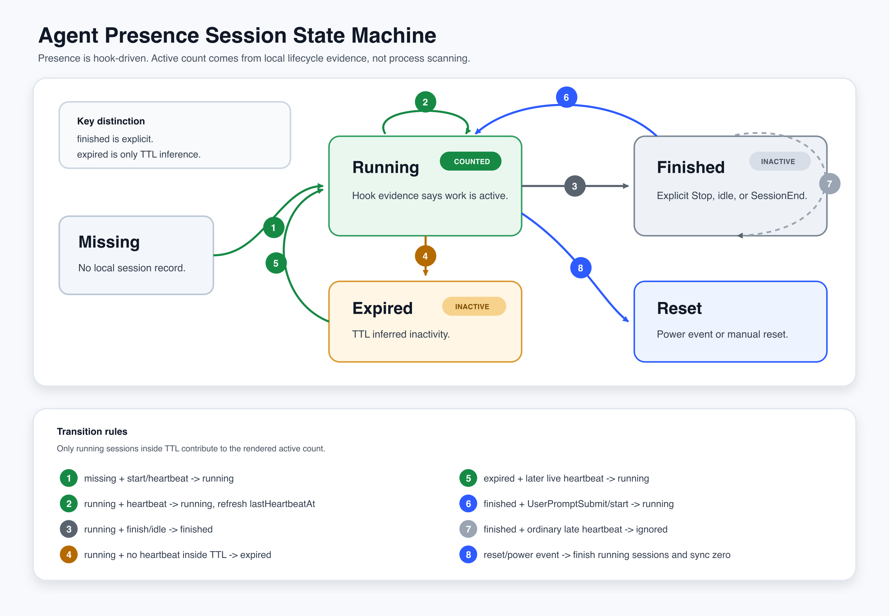

# Agent Presence Architecture

`@rivus/agent-presence` turns local coding-agent lifecycle events into a Feishu signature link-preview value. The important boundary is that it models active work from agent hooks, not from process scans.

```text
Codex / Claude Code / Gemini CLI / opencode / Pi Coding Agent / Grok lifecycle hooks
-> CLI hook records one queue record and returns
-> background worker applies the record to locked JSON state
-> TTL pruning
-> debounce renderer
-> slot provider update
-> Feishu signature link preview
```

Three paths share this pipeline:

```text
interactive path: login / setup / config / status / url / update / reset
hook path:        agent lifecycle event -> silent CLI records it -> worker applies it -> optional slot sync
deferred path:    scheduled internal flush -> render cached state -> slot sync
```

The interactive path can use prompts and rich output. The hook path must be fast, bounded, non-interactive, and safe to call from another agent runtime: it only records.

## Goals

- Count agents that are actively working.
- Keep Feishu profile writes out of the hot path by updating a reusable slot.
- Store credentials only in Keychain, libsecret, or environment variables.
- Make hooks safe to run inside coding-agent lifecycles.
- Recover from abnormal exits with TTL and power-event reset hooks.
- Support the macOS local-agent environment first, with Linux as a supported platform.
- Let `npx @rivus/agent-presence setup` be the easy install entrypoint, with installed hooks calling a stable shim under the presence home.
- Make setup and uninstall repeatable: rerunning either command should not duplicate hooks, lose user configuration, or leave half-written managed files.

## Non-Goals

- Process scanning or terminal-window detection.
- A generic status dashboard.
- Server-side session tracking.
- Windows runtime support.
- Full provider abstraction beyond the first Feishu signature slot provider.

## Runtime Components

### Local Directories

`src/config.ts` owns the local home directory. By default it is:

```text
~/.agent-presence
```

The home directory contains local state, config, logs, the hook shim, and setup-installed package runtimes. It is intentionally outside the package install directory so `npx`, global installs, and local checkouts share the same durable state.

```text
~/.agent-presence/
  state.json               local JSON state
  config.json              provider/render configuration
  agent-presence.log       hook and command diagnostics
  bin/agent-presence       stable executable hook shim, written by setup
  runtime/<version>/       pinned package and dependencies, installed by setup
```

Credentials are not stored in this directory. They live in Keychain (macOS), libsecret (Linux), or environment variables.

When setup finds a legacy `~/.codex/agent-signature` directory, it asks before copying known local files that are still missing from `~/.agent-presence`. Existing destination files are never overwritten. Once a known legacy file exists in the new home, setup removes the old copy from `~/.codex/agent-signature`; unknown files are left untouched. The legacy `~/.codex/agent-signature/config.json` path is still read when the new config file does not exist, so a skipped migration does not break first-run setup. New writes and logs use `~/.agent-presence` unless `AGENT_PRESENCE_HOME`, `AGENT_SIGNATURE_HOME`, or file-specific environment variables override the paths.

### CLI

`src/cli.ts` is the public entrypoint. It delegates immediately to `src/cli/app.ts`, which routes to one command module per command.

The CLI allows help output everywhere, then rejects unsupported runtime platforms through `src/platform.ts`. The direct installer scripts use the same guard.

Human-facing commands use `@clack/prompts` for interaction:

```text
login   -> intro, QR note, authorization spinner, outro
setup   -> conflicts, install plan, confirmation, apply results, verification, signature URL
config  -> text prompts when provider/render values are omitted in a TTY
```

Machine-facing commands stay plain:

```text
status/update/reset -> JSON or silent output
flush               -> internal cache-only deferred publisher
hook                -> pass-through `{}` for Codex or silent output for other agents
url                 -> raw URL only
```

This keeps the pretty CLI layer out of hook and automation protocols.

`setup`, `uninstall`, `doctor` and `inventory` load the harness lazily. `src/cli/harness.ts` is the sole Effect execution root, providing `HarnessLive` with `NodePlatformLive` and reporting failed programs on stderr with a non-zero exit code. Promise failures wrapped as Effect `UnknownError` print their message on one line. Other command modules may import Effect to construct programs and use its types; Effect runners, including aliases or destructured runners, and `Runtime`/`ManagedRuntime` imports or use stay in this root. Setup uses at most two harness programs: the read-only previous-release check, then the install program spanning planning across prompts, apply and verification. Queue recovery, config loading and login run between them outside Effect. The install program ends after verification; power-watcher installation, the dsh update or fresh-install prompt, and provider publishing then run outside Effect with their existing error handling and messages. The hook, status, render and usage paths do not load this root. `doctor` reports every check and fails on warnings or errors; `inventory` reads the ledger revision, entries and pending operations. Both support `--json`. Doctor's duplicate check covers command-hook files, not opencode and Pi bridge files. It recognizes the presence-specific previous-release markers and expanded installed commands; a presence home containing spaces may produce a false missing-program warning. It also reports `stale-path`, `unknown-event` and `timeout-unit` problems in other tools' hooks and exits 1 for them. Doctor does not repair agent targets, but checking the ledger lock can create harness lock files. Inventory includes every kit application's entries in the shared ledger, not only presence's.

`src/harness/bundle.ts` defines the `agent-presence` bundle for Claude Code, Codex, Gemini CLI, Grok, opencode and Pi: one observer hook spec with the package version, a stable artifact digest and `timeoutSeconds: 5` for command-hook registrations. Its command names `<presence home>/bin/agent-presence`, with `{agent}` expanded by the kit. Gemini uses its own event names and receives the timeout in milliseconds. The bundle has no legacy markers, skills or MCP servers. Doctor uses the previous-release inventory and expanded commands as duplicate markers. Setup installs the bundle through the harness and records its artifacts in the harness ledger; uninstall uses that ledger to remove them.

Setup selects install targets with `detectAgents` from `@rivus/agent-kit/discovery` for the six kit ids `claude-code`, `codex`, `gemini-cli`, `grok`, `opencode` and `pi`. It keeps the kit's built-in recipes with `auth: {}` and uses `versionProbe: false`: detection only stats commands on `PATH` and agent-owned session/state or credential paths. Empty auth probes disable credential-content and authenticating-variable reads; disabled version probes prevent agent commands from running. Presence needs evidence of installation, not a working version or login. Selection accepts `found` and `runnable`; this stat-only detection can return `found`, not prove `runnable`. A `missing` result prints an install-and-rerun instruction; `unknown` names the checks that failed and points to the explicit override.

The kit's [built-in evidence paths](https://github.com/PerfectPan/agent-kit/blob/v0.19.0/packages/discovery/README.md) are relative to each resolved data home: Claude Code has `projects/` and `.credentials.json`; Codex has `sessions/`, `archived_sessions/` and `auth.json`; Gemini CLI has `tmp/` and `oauth_creds.json`; Grok has `sessions/` and `auth.json`; opencode has `opencode.db`, `storage/message/` and `auth.json`; Pi has `sessions/` under its agent home (`~/.pi/agent/` by default). opencode uses its data home (`~/.local/share/opencode/`, or `$XDG_DATA_HOME/opencode/`), not its plugin/config home. Empty session stores count, and retained agent-owned state can establish `found` after an executable is removed. Bare agent homes, presence hooks/plugins, shared settings and MCP configuration do not count: presence installation must not create its own discovery evidence.

`setup --agents <id,...>` overrides detection with supported kit ids. A desktop-app-only installation whose CLI has never run and is absent from `PATH` requires this override. Unknown ids and kit ids without presence support are rejected. The selection goes to `planInstall` and the immediate post-install `verify`. Hooks for agents omitted by detection or the override stay unchanged. In the same install harness program, setup calls `inventory` and names unselected agents only when the ledger records entries owned by `agent-presence` for them. The notice shows `agent-presence setup --agents <id,...>` for those agents and explains that `agent-presence uninstall` removes presence hooks for all agents. An empty detected selection skips agent planning, confirmation, apply and post-install verification. Setup still prepares the selected hook-command mode and writes the shim: `package` installs or reuses the pinned runtime, while `absolute` uses the checkout CLI. A runtime installation failure stops setup before the shim or downstream watcher, dsh and provider steps; those steps run only after preparation succeeds. The previous-release check, `doctor` and `uninstall` retain all six agents as their scope, so an agent disappearing from detection does not hide old artifacts or prevent their removal.

Setup calls the kit's `verify("agent-presence", { bundle, agents })` directly. The kit compares, reports and acknowledges only presence-owned ledger entries naming a selected agent or occupying a locator desired by a selected agent. Other entries stay unchanged. The bundle also makes desired artifacts missing from both disk and ledger visible. Ordinary planning can recover pending ledger operations; unresolved pending operations fail setup.

The CLI files are split by responsibility:

```text
src/cli/app.ts              command routing
src/cli/args.ts             argv parsing helpers
src/cli/ui.ts               Clack wrapper and non-TTY fallback
src/cli/slot-sync.ts        state-lock to provider-sync bridge
src/cli/hook-context.ts     built-in source hook context selection
src/queue/                  the hook event queue: record writer, reader, worker, takeover (see Hook Event Queue below)
src/sources.ts              source registry: built-ins plus configured plugin sources
src/usage/billable-sources.ts  the billable source table (usage command and badge refresh)
src/state-store.ts          state loading, saving and the state lock (the worker and the commands)
src/cli/commands/*.ts       one command or subcommand per file
src/json-file.ts            shared JSON read and atomic write helpers
src/process-lock.ts         the kit's process lock that the state and log locks take
src/kit-platform.ts         the kit's Node platform, created once per process on first use
src/hooks/context.ts        shared hook payload/env string extraction
```

The dispatcher loads each command's implementation with a dynamic `import()` inside its `case`, so a hook run loads only the modules the hook command needs. The dispatcher statically imports argument parsing, help, the platform check, and the small hook failure fallback `src/cli/hook-output.ts`, which pulls in the queue's record writer (`src/queue/produce.ts`) and with it the kit's process lock (`@rivus/agent-kit-collab/process-lock`), taken on the platform `src/kit-platform.ts` creates; nothing heavier crosses this static boundary. When loading the hook command's module rejects, `writeHookLoadFailure` records the same `hook failed` error record and emits the same hook output as a failure inside the hook command does, leaving the exit code at 0. Only the load is covered: an error that escapes the hook command itself also reaches the generic CLI catch. The hook command is the queue's producer: it resolves the source, session and event in process, writes one record (`src/queue/produce.ts`), checks without taking it whether the worker lock is held and starts a worker when none of this release or a newer one is applying (see [Hook Event Queue](#hook-event-queue)); the worker, not the hook, appends usage, refreshes badges, updates the state and syncs the slot. The static import graph of the hook path, walked from `src/cli.ts` and the hook command, loads only repository modules, Node built-ins (`node:*`), and three npm entries: `@rivus/agent-kit/harness/events`, and `@rivus/agent-kit-collab/process-lock` with `@rivus/agent-kit/node` for the producer's lock check (both bundle `zod/mini` and load no module of the `zod` package). No other npm package is loaded, so no `effect`, no `zod`, and no `@clack/prompts`, and no setup, installer, migration, login, Clack wrapper (`src/cli/ui.ts`), or scripts code. Nor does the graph reach the modules that hold schemas or scan transcripts: the config's schema module and validated loader (`src/config-schema.ts`), the queue's schema module (`src/queue/schema.ts`), the state store (`src/state-store.ts`), the usage events log (`src/usage-events-log.ts`), the billable source table (`src/usage/billable-sources.ts`), and the usage scanners (`src/usage/scan-*.ts`). `test/hook-graph.test.ts` walks that graph and fails if it reaches any of them. A static setup import in the hook graph would defeat this split even when tree-shaking would discard it elsewhere.

The package exposes both binaries:

```text
agent-presence   primary CLI
agent-signature  compatibility alias for older hooks
```

### Stable Hook Shim

Setup writes `<presence home>/bin/agent-presence` before the watcher and dsh steps; when agents are selected, it writes the shim after install confirmation and before applying the harness plan. `src/harness/shim.ts` writes a temporary file in the same directory, sets mode `0755`, and atomically renames it over the shim on every setup unless `--no-hooks` is passed.

The `/bin/sh` script directly `exec`s Node and the CLI, forwarding `"$@"`. It uses setup's `process.execPath` while that file exists, otherwise `node` on `PATH`. The default `--hook-command package` selects `<presence home>/runtime/<version>/node_modules/@rivus/agent-presence/dist/src/cli.js`. `--hook-command npx` remains an alias for `package`; it does not execute `npx`. With `--hook-command absolute`, the CLI is the checkout's `dist/src/cli.js` and setup installs no runtime. `AGENT_PRESENCE_HOOK_COMMAND` accepts the same modes. Every path is quoted with the shared `shellQuote`. Absolute mode requires the checkout to remain available.

In default mode, setup installs its exact published package version into a temporary sibling of `<presence home>/runtime/<version>/`. This follows install confirmation when agents are selected; an empty selection skips that confirmation. The installation command is:

```bash
npm install --prefix <temporary-runtime-directory> --registry=https://registry.npmjs.org --omit=dev --no-audit --no-fund --ignore-scripts @rivus/agent-presence@<version>
```

Setup uses `process.env.npm_execpath` when it points to npm's CLI script, otherwise `npm` on `PATH`. A runtime is reused only when its package manifest names the requested version and its `dist/src/cli.js` exists. A new runtime is renamed into place only after installation succeeds. On failure, setup cleans the temporary directory, discards any held harness plan and exits non-zero before writing the shim or any agent target or running downstream steps. npm and registry access are setup-time dependencies; the hook path runs the local CLI directly.

Before runtime installation, setup reads which runtime the previous shim selected; when agents are selected, this follows install confirmation. Pruning runs only at the end of a successful setup, under the runtime lock, after the watcher, dsh and provider steps. It retains this setup's version, if present, the runtime selected by the previous shim, and the runtime selected by the shim at prune time. It removes only other version directories and leftover `runtime/.install-*` installation directories; directories with other names are preserved. Keeping the shim's selected runtime protects an overlapping setup whose shim switch completed before an older setup reaches cleanup. Absolute-mode setup also keeps the previous shim's runtime even though it installs no runtime. Provider errors reported by the provider step do not skip pruning. The dsh plugin calls `<shim> hook --source dsh …`, and the macOS power watcher calls `<shim> reset --force --silent`. Their standalone checkout install scripts keep an existing shim or create an absolute-mode shim when none exists.

The installed hook command is `<shim> hook --agent {agent} 2>/dev/null || echo '{}'`, with the shim path shell-quoted. Its text is identical in both modes and stays stable across package upgrades; setup rewrites the shim's contents to select the package version or checkout. Uninstall removes the shim and the entire `<presence home>/runtime/` directory after the harness removal step.

Runtime installation and shim switching share a process lock at `<presence home>/runtime.lock.db` with pruning. Setup releases the lock before applying the harness plan and running watcher, dsh and provider steps. At successful cleanup it takes the lock, re-reads the shim with `readPresenceShimRuntimeVersion()`, and retains that version alongside this setup's version and the previous shim's version. Concurrent setups cannot prune a runtime between its installation and shim switch. The lock file stays outside `runtime/` so runtime removal never deletes it.

### Configuration

`src/config.ts` owns durable local configuration. Provider-specific options stay under the provider id, so the generic presence model does not need Feishu-specific names.

Commands, the queue worker, and a command's takeover parse the config file with zod/mini schemas when they load it (`src/config-schema.ts`): a field or map entry whose value does not parse loads as missing — absent, not an `undefined`-valued key — and is reported once per run on stderr as `config: ignored <path> (<reason>)`, the rest of the file loads, keys the schema does not know are kept at every level, and a non-object root loads as `{}`. Every write command starts from the file's content as read. The object whose fields the command sets is taken from the validated config (its broken values dropped, unknown keys kept) with the change applied; every other key at every level, ancestors and siblings, stays as it is in the file — a broken raw value's index keys are never spread into the file, and a sibling the command does not change keeps its broken value. An ancestor that is not a map is replaced by a map holding the change, and a reset under a non-map ancestor removes the key. When the root itself is not an object, the write base is `{}` and the change starts a fresh config. `config show` lists the dropped values as `configIssues`. The hook path keeps the schema-free read in `src/config.ts` — loading `zod` costs a hook about 22 ms ([Plan 0003](plans/0003-hook-event-queue.md), 3.2) — and resolves only its own source's entry (the user's entry for that id, else the shipped default), so a broken entry of another source cannot fail the hook. A broken entry of the hook's own source, or a `null` root, still fails open as one `hook failed` error record with exit 0; any other non-object root (an array, string or number) reads as no user entries, and the hook resolves the shipped default. The worker drops broken values silently.

The provider ids are:

```text
magic-builder      default; preview served by a published magic-builder FaaS
feishu-signature   direct l.garyyang preview; also the slot backend both providers write
```

`providerId()` resolves the `--provider` flag, then `AGENT_PRESENCE_PROVIDER` / `AGENT_SIGNATURE_PROVIDER`, then `config.provider`, then the default (`l-garyyang` is a legacy alias of `feishu-signature`). Bare `setup` and `url` use `defaultCommandProviderId()`, which ignores a persisted `config.provider` so an older config that still names `feishu-signature` does not pull them off the default; the flag and environment overrides still apply. Which provider is active never changes the write path: hooks, `update`, `flush`, and `reset` always publish to the same slot (see [Slot backend vs. provider](#slot-backend-vs-provider)).

The `feishu-signature` provider can be configured with a base URL, preview base URL, image key, and target URL. Token and slot id are credentials, so they are resolved through `src/secret.ts` instead of being embedded in the URL.

### State Store

`src/state-store.ts` loads and saves the local state as JSON under the user state directory. Loading parses the file with zod/mini schemas: a field or map entry whose value does not parse loads as missing, never as a failed load, and top-level fields the release does not know are dropped on the next save. The hook event queue's fields `queueApplied` and `queueOwed` ([Plan 0003](plans/0003-hook-event-queue.md), 3.5) are the exception: their schemas (`src/queue/schema.ts`) are loose at every level, so keys and fields the release does not know load as they are and are written back on the next save; a value that is not a list or an object loads as absent, and an entry that does not parse is dropped. `src/state.ts` keeps the state types and the session rules (`applyAgentEvent`, `isSessionBoundaryEvent`) without schemas or I/O, so the hook path can use them without loading zod. Updates are guarded by the state lock (`withStateLock` in the state store) so the worker and the commands that took over do not clobber each other. The state lock is the kit's process lock (`@rivus/agent-kit-collab/process-lock`) on `<state>.lock.db`: a SQLite database that the kernel unlocks when its holder exits or crashes, so a lock is never reclaimed. A writer waits up to 2 seconds for it and then fails. The `<state>.lock` directory that earlier releases locked is left alone, because those releases delete that path.

State has two layers:

```json
{
  "sessions": {
    "thread_id": {
      "id": "thread_id",
      "source": "codex",
      "kind": "coding",
      "status": "running",
      "startedAt": 1778576582452,
      "lastHeartbeatAt": 1778576891386
    }
  },
  "lastSlotUpdateAt": 1778577015486,
  "lastValue": "1 个 AI 牛马正在搬砖 | codex 1"
}
```

`sessions` is the event-derived truth. `lastSlotUpdateAt` and `lastValue` are the renderer/provider debounce checkpoint.

### Hook Event Queue

A hook run no longer applies presence's work itself. It records one event in a durable queue and returns; one background process per state file applies the recorded events, does the follow-up work and publishes as the direct path did, with two exceptions while a process of an older queue release holds the worker's place: its commands run without newer pending records, and work only a newer release can do waits for a newer worker ([Plan 0003](plans/0003-hook-event-queue.md) section 7, decided option (a)). The plan owns the reasoning and the edge cases; this section is the current shape.

**The producer (the hook command).** `hook` interprets the payload in process (the interpretation rules above), takes no lock, writes no log line and reads no credential or transcript. In order it reads `<state>.epoch`, checks the `<state>.disabled` tombstone, writes one record (temporary file, then `rename` — the rename is the recording point), and checks with the kit's `isProcessLockHeld` whether a process holds the worker lock: if none does, or the holder's `<state>.worker.v` shows an older release, it starts a `agent-presence worker` as a detached process; otherwise the holder applies the record. It prints its output (`{}` unless `--silent`) and exits 0 in every case; an event that cannot be recorded is lost. A run records one `event` record per interpreted event, one `skip` record (`missing-session-id`, `no-presence-source`, `ignored-event`) per skipped one, one `error` record per source-resolution diagnostic, and one `hook failed` error record when its own work throws — never a stop request.

**The queue directory and records.** `<state file>.queue/` (mode 0700) holds one 0600 file per event, named `<recordedAt>-<pid>-<hex>.json`. A record carries its record version `v`, its id, the recorded time, the epoch the producer read, and the normalized fields of the event — source, event name, session id, project, dsh usage when the source reports it, the transcript-root variables (`scanEnv`) on session boundaries, and payload key names for the diagnostic log. It never carries prompt text, tool arguments or credentials. Records an applier cannot parse move to `queue/failed/` and are kept for 7 days.

**The worker (`agent-presence worker`, not listed in help).** It holds the worker lock (`<state>.worker.lock.db`, the kit's SQLite process lock, never deleted) and writes its record version to `<state>.worker.v` while it holds the lock. Two lanes run concurrently: the apply lane lists the queue every 250 ms and, under the state lock, applies each batch in recorded order at its recorded times, saves the applied ids (`queueApplied`) and the follow-up work the records owe (`queueOwed`: dsh usage appends, per-source usage refreshes, the rendered sync), then deletes the applied files; the follow-up lane works off the owed items one at a time — appending dsh usage with the record id, scanning the owing source's transcripts with the recorded environment, publishing the rendered value through the usual debounce. A worker exits when idle (5 minutes with nothing pending), for a command's stop request, for a record of a newer release (it leaves the record to that release's worker), for the tombstone, or when applying keeps failing for a whole idle interval. Every exit deletes `<state>.worker.v` and releases the lock, then lists the queue once more: an idle worker that finds a record retakes the lock (or waits as a started worker when a command's request is live or another process took it), a holder that stopped for a stop request and a command that leaves start a worker when records or owed work remain, and a worker leaving for a newer record, for the tombstone, or because applying kept failing for a whole idle interval starts none.

**Commands take over.** `status`, `reset`, `flush` and `update` write a stop request (`<state>.worker.stop.<token>`, their pid, touched every 2 seconds while they wait), take the worker lock within 10 seconds or fail, apply the pending records, append the owed dsh usage (except `reset`, which leaves refreshes and rendering to the next worker) and then run today's command code. When a command leaves it starts a worker if records or owed work remain. `worker --stop` takes over, applies and works off everything pending, then writes the tombstone.

**Tombstone and epoch.** `uninstall --all` writes `<state>.disabled`, takes over, deletes the queue directory, the stop-request files and the state, and keeps `<state>.worker.lock.db` and `<state>.epoch`. While the tombstone exists, producers record nothing, workers exit, and the commands change nothing. `setup` (right after its legacy-home migration) removes the tombstone: it deletes the stale records, raises the epoch, and hooks record again; a record written with the old epoch around an uninstall is deleted unapplied.

**Upgrade and downgrade.** Upgrading from a release without the queue: uninstall that release with its own `agent-presence uninstall` first, then install and run `setup` — the two releases do not run side by side. Upgrading between two releases with the queue needs no step: an older worker leaves when it lists a newer record, and the worker that record's producer started takes over. Downgrading runs `agent-presence worker --stop` with the new release first, then the previous release's `setup` if that release has the queue.

### Hook Normalization

The hook pipeline maps each agent's lifecycle vocabulary to the shared session state:

```text
start event      -> running
heartbeat event  -> running with fresh lastHeartbeatAt
finish event     -> finished
idle event       -> finished
```

Current source mapping:

```text
Codex       SessionStart, UserPromptSubmit, PreToolUse, Stop
Claude Code SessionStart, UserPromptSubmit, PreToolUse, PostToolUse, Stop, StopFailure, SessionEnd, SubagentStart, SubagentStop
Gemini CLI  SessionStart, BeforeAgent, BeforeTool, AfterTool, AfterAgent, SessionEnd
opencode    session.created, command.executed, file.edited, message.*, permission.*, session.*, todo.updated, tool.execute.*
Pi          before_agent_start, turn_start, tool_execution_start, tool_execution_end, agent_end, session_shutdown
Grok        session_start, user_prompt_submit, pre_tool_use, post_tool_use, stop, stop_failure, session_end, subagent_start, subagent_stop (snake_case wire names; the PascalCase registration keys map the same way)
dsh         agent/session-start, agent/pre-step, tools/pre-execute, tools/result, agent/turn-stopping (via managed dsh plugin)
```

Hooks print `{}` unless invoked with `--silent`, including Codex hooks that require valid pass-through output. Earlier installations may carry `--silent` for Claude Code, Gemini CLI, opencode and Pi.

`hook --agent <kit agent id>` is the form setup installs. It reads the payload with `readHookEvent` from `@rivus/agent-kit/harness/events`, attributes the event to the presence source of the sniffed agent (`claude-code` → `claude`, `gemini-cli` → `gemini`, and `codex`, `grok`, `opencode`, and `pi` unchanged), and maps `nativeEvent` onto the internal names this state machine already uses, by the signal rule below. An agent with no presence source, such as Cursor running a Claude Code hook, logs one `hook skipped:` line and ends on the same skip path as a missing session id. For `hook --agent opencode` the session id is the one the kit's opencode dialect reads: the id the event names, or, for an event that names none (`file.edited`, a `session.error` without `sessionID`), the `currentSessionId` the kit bridge adds once it has seen a session; an event with neither is skipped as a missing session id. Stdout is presence's own rule for every agent and event: `{}` unless `--silent`. The kit dialect's `passThrough` is not consulted.

After batch 5, opencode and Pi have only the kit-bridge forms `hook --agent opencode` and `hook --agent pi`: setup refuses while their old plugins or extensions remain. Their source resolvers retain only the session identity and project resolution the `--agent` path calls; the old opencode bridge's wrapped `{ event }` payload lookup and `OPENCODE_SESSION_ID` fallback are removed. `hook --source <id> --event <internal name>` and `hook --source <id>` with an internal event from its resolver keep their internal-name behavior for `claude`, `codex`, `gemini`, `grok`, `dsh`, and configured sources; configured sources reusing `builtin:opencode` or `builtin:pi` follow the same shipped resolver rule. Internal names are the Claude-style names the state machine uses, `Heartbeat`, and lowercase `start`, `finish`, and `heartbeat`. Raw `session.created`, `session.deleted`, `session.error`, and `session.idle` names count as heartbeats in direct `hook --source <any> --event <raw name>` calls and configured `match` sources resolving those names.

Signal rule for `hook --agent`: a per-agent table (`src/cli/hook-interpret.ts`) maps each native event name to an internal name, and `normalizeEvent` turns that into start, heartbeat, or finish. The mapped internal names keep their `--source/--event` signals, even where the kit phase differs. A name the table does not list takes the kit phase: start and finish as they are, and activity, blocked, or unknown as a heartbeat, because presence has three statuses and a permission or question prompt is activity.

```text
start      SessionStart (Claude Code, Codex, Gemini CLI; a compact one too), Grok session_start, Gemini BeforeAgent,
           opencode session.created, Pi before_agent_start and agent_start
heartbeat  tool, message, edit, and other activity; UserPromptSubmit (Claude Code, Codex, Grok user_prompt_submit);
           opencode session.status other than idle, permission.asked/updated, question.*; Pi turn_end
finish     Stop, StopFailure, SessionEnd and their Grok spellings, Gemini AfterAgent; opencode session.status idle,
           session.idle, session.error, session.deleted; Pi agent_end, agent_settled, session_shutdown
subagent   Claude Code SubagentStart/SubagentStop and Grok subagent_start/subagent_stop start and finish
           the subagent's own session and are not session boundaries
ignored    Pi session_start
```

Where this departs from the kit phase, it keeps presence's state machine intact. `UserPromptSubmit` and opencode's busy `session.status` are kit turn starts, but a start would reset a running session's `startedAt` and refresh the usage badge on every prompt; as a heartbeat, `UserPromptSubmit` still reopens a finished session. The kit counts a `compact` `SessionStart` as activity; presence restarts the session as before. Pi `session_start` only means the Pi UI is open (see the Pi paragraph below). The Claude-style payload names `UserPromptSubmit`, `PreToolUse`, `PostToolUse`, and `Stop` keep their signals in `hook --agent gemini-cli`; they are not in the Gemini registration set setup installs. Presence does not use the kit's `reduceLifecycle`/`heartbeatSignal` policy, which ignores session-scope starts and never starts or finishes a subagent session.

The seven sources above are built in. They live in a source table that a user's config can extend, override, or disable without a core change; see [Source Table](#source-table).

For Pi specifically, the extension intentionally does **not** treat the Pi `session_start` event as an active-session signal — that event fires whenever the Pi TUI opens, including when the user has not yet submitted a task. Activation is gated on `before_agent_start`, which only fires after the user submits a prompt. Heartbeats come from `turn_start` and `tool_execution_*`. Finishes come from `agent_end` (turn done) and `session_shutdown` (Pi quit, reload, or session switch).

For dsh, there is no kit adapter: `setup` automatically rewrites an existing presence Cordis plugin identified by its marker to call the shim, without prompting, including in a non-interactive terminal or with `--yes`. Only a fresh installation asks for confirmation, and is offered only when dsh is detected in an interactive terminal. If reading the plugin to check its marker fails, setup prints one note, skips the dsh step and continues provider setup and runtime pruning. `--no-hooks` neither inspects nor rewrites the plugin. The single-file plugin lives in `~/.dsh/plugins/` and is registered in the home-level `~/.dsh/cordis.patch.yml` (which applies to every profile). The plugin bridges dsh lifecycle events to `agent-presence hook --source dsh` and reports each model call's token usage in the hook payload, which the producer copies into the record; the worker appends it to a local usage log (`~/.agent-presence/usage-events.log`, `src/usage-events-log.ts`) under that file's log lock. A line can carry the id of the record it came from, and the reader counts a repeated id once. The dsh `scanUsage` reads that log back through a zod/mini line schema, so dsh contributes to the same usage windows and totals as the transcript-scraping sources without scraping dsh's zstd transcripts.

Setup installs Grok hooks through the harness bundle. The source is registered in the table (it appears in `source list`) and accepts Grok hook payloads through `agent-presence hook --source grok` and through `hook --agent grok`. With `--source grok --event <presence event name>`, the `--event` name drives the lifecycle mapping. Without `--event`, and with `--agent grok`, the payload's event name maps through the same Grok table (`GROK_EVENTS` in `src/hooks/grok.ts`), snake_case or PascalCase; on `--source grok` a name outside it counts as a heartbeat. The `builtin:grok` resolver reads the payload with the kit's Grok dialect (`readHookEvent`): the event name from `hookEventName`/`hook_event_name`, the session id from `sessionId`/`session_id` (env fallbacks `GROK_HOOK_EVENT`/`GROK_SESSION_ID`), and the project from `cwd`, falling back to `PWD`. Subagent start and stop compose the session id the same way Claude's resolver does, from `subagentId`/`subagentType`. Grok has no transcript scanner yet, so it contributes presence only.

The harness ledger owns the artifacts setup installs. Planning compares the desired bundle, ledger and agent targets; applying the accepted plan preserves unrelated configuration and avoids duplicate registrations. The bundle and uninstall supply no legacy command markers, so entries from previous releases require that release's own uninstall. Before planning, setup refuses entries reported by the read-only previous-release check; see [Upgrading Previous Installations](#upgrading-previous-installations).

### Session State Machine



The editable SVG source for this diagram lives at [`assets/presence-state-machine.svg`](assets/presence-state-machine.svg).

Each session record has one of three statuses:

```text
running   explicit local evidence says this agent session is working
finished  an explicit finish/idle event ended the current work turn
expired   TTL inferred inactivity because no heartbeat arrived in time
```

`finished` and `expired` are intentionally different. `finished` comes from an explicit lifecycle event and protects the state from late async hook traffic after a turn has stopped. `expired` is only an inactivity inference, so a later live heartbeat from the same session can reopen it.

The shared transition rules are:

```text
missing session + start/heartbeat       -> running
running + heartbeat                     -> running, refresh lastHeartbeatAt
running + finish/idle                   -> finished
running + no heartbeat inside TTL       -> expired
expired + start/heartbeat               -> running, refresh startedAt and lastHeartbeatAt
finished + ordinary late heartbeat      -> finished, ignored
finished + UserPromptSubmit/start       -> running, new active turn for same agent session
unknown finish id + matching source/project running session
                                         -> finish latest matching running session
reset / power event                      -> finish all running sessions, preserve cached usage, and sync zero
```

This gives the model two recovery paths without process scanning:

- Missed finish hooks are cleaned up by TTL expiry.
- Long-running sessions that keep working after a TTL expiry can become active again on the next real heartbeat.

### Active Semantics

Active means "currently doing agent work", not "the terminal is open".

```text
running session with heartbeat inside TTL -> active
finished session                         -> inactive
no heartbeat for TTL                     -> expired and inactive
expired session with later heartbeat     -> running again
sleep / lid close / logout / shutdown    -> reset to 0
wake                                     -> reset to 0 again
```

The default TTL is 3 minutes. This handles abnormal exits, hard kills, and missed finish hooks without scanning local processes. An expired session is not a terminal state; it is inactive until a later real heartbeat proves that the same agent session is working again.

### Rendering

`src/render.ts` groups active sessions by source and formats the slot value:

```text
0 -> AI 牛马暂未开工
1 -> 1 个 AI 牛马正在搬砖 | codex 1
N -> N 个 AI 牛马正在搬砖 | codex W · claude X · gemini Y · opencode Z
```

Templates are configurable through `agent-presence config render` and environment variables. Rendered values are capped at 200 characters before provider update.

### Debounce And Provider Updates

Slot writes are rate-limited because the slot provider should not be hammered by hook traffic. The worker applies recorded events to local state, then the renderer compares the newly rendered value with `lastValue` and `lastSlotUpdateAt`; the owed rendered sync (`queueOwed.renderedSync`) is what drives that comparison off the queue.

Normal updates obey the debounce interval. `update --force` and `reset --force` bypass the local debounce when the user or power watcher explicitly asks for a sync.

A debounced or rate-limited write schedules the internal `flush --force --silent` command. `flush` renders the already-persisted presence and usage cache; it never collects transcripts. This keeps retrying provider delivery separate from the explicit `update` command, whose application semantics include a complete usage refresh.

Network I/O is kept outside the state mutation lock. That keeps hook contention small and prevents a slow provider request from blocking unrelated lifecycle writes.

### Provider Registry

`src/providers/types.ts` defines a capability-oriented `PresenceProvider` interface, and `src/providers/registry.ts` exposes `createProvider(id, { config, credential })`. CLI commands resolve a provider through the registry and call `assertSupports*` for the capability they need (login, publish, signature url) instead of importing a storage backend directly. This is the seam new providers plug into.

Capabilities are optional because not every provider supports every operation:

- `createQrCode` / `getLoginStatus` — login.
- `publishValue(value)` — push the rendered value to wherever the provider stores it.
- `getInfo()` — raw backend read for `status --remote`.
- `buildSignatureUrl()` — the link-preview URL the signature embeds.
- `getRemotePreview()` — a front-end provider's own server-rendered preview (magic-builder's FaaS output).

#### Slot backend vs. provider

The two shipped providers are not independent backends: they read and write the **same** slot. That shared storage is modelled explicitly as a `SlotBackend` (`src/providers/slot-backend.ts`), implemented by `LGaryYangSlotBackend`. Both `feishu-signature` and `magic-builder` _compose_ the same `SlotBackend` for login/publish/info and differ only in the signature URL (and, for magic-builder, the `getRemotePreview` FaaS read). Neither provider depends on the other.

The capability layer is deliberately generic (`publishValue`, not `updateSlot`) so a future provider with its own, slot-unrelated storage can implement `PresenceProvider` directly and never touch `SlotBackend`. Its own credential model and login flow would be added alongside at that point; the registry seam itself does not change.

### Source Table

Sources (which agents feed presence) are modelled as a single **source table**, so first-party and third-party agents are handled uniformly. `src/cli/hook-context.ts` defines one `SourcePlugin` interface (`{ id, resolveHookContext(payload, env) }`) and keeps the seven built-in resolvers (`codex`, `claude`, `gemini`, `opencode`, `pi`, `grok`, `dsh`) as its reference implementations in `BUILTIN_SOURCE_PLUGINS`. Each entry also lists, as `scanEnv`, the environment variables that locate its transcripts (names from `SCAN_ENV`: `CLAUDE_CONFIG_DIR`, `CODEX_HOME`, `GEMINI_CLI_HOME`, `GROK_HOME`, `XDG_DATA_HOME`, `PI_CODING_AGENT_DIR`), and the usage scan reads those variables only through these names. The table holds no scanner, so resolving a source loads no scanner module. `src/sources.default.json` ships a default table that lists those built-ins as `builtin:<id>` handlers.

`src/sources.ts` computes the **effective table** by merging the user's `config.plugins.sources` over the shipped defaults by id (`mergedSources`): a same-id entry **overrides** a built-in, a new id **adds** a source, and `enabled: false` **disables** one. `resolveHookContextForSource(source, payload, config)` then resolves an id from that table. Not writing a `plugins.sources` (or a given id) leaves the shipped default in effect. Downstream of context resolution the pipeline is already source-agnostic — `AgentSession.source` is a plain string, `renderDetails` groups by it verbatim, and `normalizeEvent` understands the PascalCase lifecycle events — so a source only needs to turn its hook payload into `{ sessionId, project, event }`.

A table entry resolves by kind:

- **`builtin:<id>`** — reuse the shipped in-code resolver. **Trusted** (first-party, ships with the package): receives the raw environment, since built-ins rely on env fallbacks.
- **Declarative `match`** — no code. Each of `sessionId` / `project` / `event` is a `pickString`-shaped field spec (`envKeys` / `payloadKeys` / `nestedPayloadKeys` / `payloadFirst`), so it reaches nested payloads and controls env-vs-payload precedence like a built-in.
- **JS `handler`** — an absolute path or npm specifier for an ESM module whose `default` export is a `SourcePlugin`. agent-presence `import()`s it in-process during a hook.

Trust follows the `builtin:` marker, not the id: a user who overrides `codex` with their own `handler` gets the guarded path. Because a `handler` runs in-process with full CLI trust (including credential access), loading is guarded: it is opt-in (shipped defaults are all `builtin:` and run no user code), the handler receives a **curated env** with credential-bearing keys stripped, an absolute-path handler is refused if it is a symlink / not owned by the current user / world-writable, and `handler` entries are ignored entirely if `config.json` itself is world-writable or not user-owned. Handler failures fail open — logged with non-secret fields only, degrading to an empty context — so a source can never break a hook. `agent-presence config show` prints the merged table as `sources`, each with its `origin` (`default`/`config`), `kind` (`builtin`/`handler`/`match`), and `overridesDefault` flag.

Source table invariants:

- `resolveHookContext` must be synchronous and do no I/O: it runs on the hook hot path. The framework cannot enforce that for a `handler`. Managed command hooks have an agent-side timeout, but asynchronous bridge delivery has no child-process timeout; the handler must honor the synchronous, no-I/O rule itself.
- A handler is imported lazily and cached per process. Each hook is a fresh short-lived process, so a handler is imported at most once per hook and only when its source fires; `builtin:` entries are static imports.
- A bare handler specifier resolves only from the plugins dir's `node_modules` (`createRequire` anchored there), never from the user's cwd or an ancestor `node_modules`. An absolute path is imported through `pathToFileURL` after the ownership checks above.
- The ownership checks `lstat` the handler file and its parent directory before `import()`. A same-user process can still swap the file between the check and the import; closing that window needs fd-based loading and is not done. The practical bound is that the operator owns the file and its directory and vets the code.
- A runtime `import()` bypasses the install-time supply-chain controls this repository applies to its own dependencies (frozen lockfile, the `allowBuilds` allowlist for dependency build scripts, `minimumReleaseAge`). Prefer absolute paths under a user-owned directory, and use an organization-reserved npm scope for bare specifiers to avoid dependency confusion.
- If `sources.default.json` is missing at runtime, `defaultSources()` falls back to the in-code built-in ids as `builtin:<id>`, so presence never silently stops counting first-party agents.
- Event names outside `normalizeEvent`'s vocabulary count as heartbeats; a `handler` or `match.event` should normalize them first.
- `setup` installs agent-side hooks only for the built-ins, and `help` lists only them. A configured source's agent side is delivered through that agent's own mechanism.

#### Installing a source by package

`agent-presence source add <npm-package>` downloads a source-plugin package and registers it, so operators do not hand-edit config. It accepts only a plain registry spec (`pkg`, `pkg@range`, `@scope/pkg[@range]`); git, URL, tarball, `file:`, and `npm:` alias specs are rejected because their installed directory name would not match the recorded handler. It `npm install`s (via `execFile`, with `--ignore-scripts`) into an isolated plugins dir (`~/.agent-presence/plugins/`, override `AGENT_PRESENCE_PLUGINS_DIR`) so packages land under `<pluginsDir>/node_modules`, never in the CLI's own install; use `--registry` (or `AGENT_PRESENCE_REGISTRY`) for an internal registry. It then validates the package exports a real `SourcePlugin`, and records `plugins.sources.<id> = { handler: "<packageName>" }` — the merged table stays the one source of truth. At hook time a bare specifier resolves from the plugins dir via `createRequire`. `source list` prints the merged table; `source remove <id>` unregisters and (unless `--keep-package`) uninstalls the package; `uninstall --all` removes the whole plugins dir. Because `add` downloads and runs third-party code in the credential-bearing process, it prints a trust notice and requires `--yes` or an interactive confirmation.

#### Token usage (`scanUsage`)

Token/cost accounting is a **capability of the same source table**, not a separate subsystem: a source that contributes usage is billable; a `match` source contributes presence only. `billableSources(config)` (`src/usage/billable-sources.ts`) enumerates the merged table's billable sources, in table order, through the **same** trust/resolution path as presence (`resolveSourcePlugin` in `src/sources.ts`: `builtin:` → the built-in's usage capability; JS `handler` → the guarded, cached loader and its own `scanUsage`; `match` → skipped). Only the `usage` command and the signature-badge refresh import that module, so the hook path reaches no scanner. `collectWindowUsage()` iterates that list — no hardcoded source set — so `agent-presence usage` and the signature badge both cover every billable source dynamically. Usage stays **after-the-fact transcript scanning** (ccusage-style), independent of the hook payload; hook events never carry token counts.

Every built-in except `dsh` is decoded by `@rivus/agent-kit/transcript/usage`: `billableSources` marks each with its kit agent id — the mapping lives in one place, `KIT_AGENT_BY_SOURCE` in `src/usage/kit.ts` (`claude` → `claude-code`, `gemini` → `gemini-cli`, `codex`, `opencode`, `pi`, `grok` identity) — and one stateless `scanUsage(platform, { agents, since, until })` call per window decodes them together, read from the platform's environment (the agent-home variables of `SCAN_ENV`, which the kit's home rules resolve; a set `GEMINI_CLI_HOME` moves the Gemini root to `$GEMINI_CLI_HOME/.gemini/tmp`, matching Gemini CLI's layout). Every scan re-reads the whole window and replaces that window's per-source snapshots; no scan state is kept, so overlapping scans are idempotent and a price change applies on the next scan. A custom JS `handler` source keeps its own `scanUsage`, and dsh keeps its own usage-log reader; their records (four buckets, input excluding the cache) are converted to the kit record shape at the totals boundary (`toKitRecord` in `src/usage/kit.ts`), so one summarizer serves every source. Records are grouped under the id of the source that was scanned; a configured entry reusing a built-in (`handler: "builtin:claude"` under another id) reports the same contribution as the built-in's own entry, exactly as per-source scans did.

Signature accounting keeps a per-window, per-source snapshot in state. Same-day session-boundary events owe a refresh of only the contribution owned by their source (`opencode` scans opencode, `codex` scans Codex, and so on), which the worker's follow-up lane scans, and then the renderer aggregates the configured source snapshots. The worker scans with its own environment except for the agent-home variables: every variable in `SCAN_ENV` is set to the value the boundary recorded, or unset when none was recorded, whichever source the refresh scans — so a promoted first-boundary refresh reads no home variable the producer did not copy, and a source whose variable was not recorded reads its default root under the worker's home until its own boundary records one. Two paths work off a refresh: the worker's follow-up lane and `worker --stop`'s takeover scan through the recorded environment above; the standalone `usage` command and `update`'s explicit full refresh run in the user's shell and read that environment instead (`flush`, `status`, and `reset` work off no refreshes at all). This prevents one agent's lifecycle event or scanner version from recalculating another agent's ledger. The first source boundary after midnight, or the first boundary when no aggregate timestamp exists, is the deliberate exception: that refresh fills what the day lacks — it scans its own source plus every built-in that has no snapshot from this day and no owed refresh entry bounded on this day (such an entry scans its source with its own recorded environment and time), giving inactive sources a current-day zero contribution so they cannot block the aggregate indefinitely, and never overwriting a snapshot it did not scan. An explicit `agent-presence update` also scans and replaces the complete built-in snapshot set; deferred flushes and power-event resets only re-render the cache. A signature refresh is atomic across its configured windows and sources: if any scan fails, the previous cache remains intact for the next boundary to retry. A refresh also takes an abort signal: aborted before or while its scans run, it stops waiting for them, leaves the cache as it was, and reports that it did not complete. Once the scans have finished, an abort no longer stops it: it waits for the state lock, saves, and reports completion, as it does after a failed scan. Overlapping refreshes merge snapshots monotonically by scan time, so a slower older scan cannot overwrite newer usage. During migration from a legacy cache that already has a current aggregate timestamp but lacks some window snapshots, a partial source refresh preserves the previous badge and timestamp until every configured source has a compatible snapshot; it never presents a partial or cross-day value as the total.

A trust detail survives from the scanner table: **the hot path stays first-party and source-scoped within a calendar day.** The signature-badge refresh calls `billableSources(config, { includeHandlers: false })`, then same-day hooks select only their own built-in source and never `import()` a third-party `handler` to probe for `scanUsage`. The first boundary after midnight fills the built-ins the day lacks, and an explicit update scans all built-ins. The standalone `usage` command is interactive and includes handlers.

Decoding corrections the kit adopts, each fixture-tested (`test/usage-kit-scan.test.ts`): Codex reads each rollout's own `thread_settings_applied` service tier and prices its records with the priority multiplier (`2`) per record, and from its first `token_usage_record` counts per-record usage, skipping unchanged `token_count` totals; Gemini CLI counts a migrated chat only once, from its `.jsonl` file, and adds tool-use prompt tokens to the input; Claude Code keys a turn by `requestId` (falling back to the message id when a gateway recorded none) and keeps, per request, the occurrence with the most tokens; Pi skips the copied parent entries at the start of a forked session; a count a transcript does not report stays absent instead of `0`.

Each decoder finalizes on its own schedule, and none of it depends on scan state: a Claude Code request stays unreported until four newer requests have been written in its conversation lane or the source has been quiet for 30 minutes; an opencode database message without a completion time counts once it completes or the database goes quiet for 30 minutes; the Gemini CLI, Pi, and Codex decoders count a request as soon as its record is complete. On the badge this lag compounds with the refresh rule: the worker scans at the boundary's time and, within a day, only the boundary's own source, so the requests Claude Code still held at the day's last boundary for that source count only at that source's next boundary more than 30 quiet minutes later — when there is none, the badge leaves them out for the rest of the day (the standalone `usage` command, which scans to the current time, reports them sooner). This under-report is accepted product behavior, not worked around.

Cost semantics go through the kit (`@rivus/agent-kit/cost`): a per-message cost an agent logged (Pi, opencode, Grok) wins as-is, unmultiplied, even `0`; otherwise each token count is charged at the model's price and the result is multiplied by the record's billing-tier multiplier; an unknown model has no cost and renders `n/a` while its tokens stay exact. Totals follow the kit record convention — `inputTokens` includes cache reads and writes, `outputTokens` includes reasoning, and the badge total is `inputTokens + outputTokens` — with one reporting difference: presence's `SourceUsage` rows and the `usage --json` fields keep `inputTokens` as the input that was neither read from nor written to a cache (the kit's input minus its cache counts), while a kit record itself carries the cache-inclusive input; `totalTokens` is the kit's two-bucket sum, the number the badge renders. The primary price table is a committed **LiteLLM snapshot** (`src/usage/litellm-pricing.json`) generated by `pnpm run update-pricing`, filtered to the model ids agent-presence sources actually record (for example `gpt-5.6-sol`, `claude-sonnet-5`, `deepseek-v4-pro`, `gemini-3-flash-preview`) rather than the full LiteLLM database. A weekly GitHub Action regenerates the snapshot and opens a PR when those supported-model prices drift. `createPricing` (`src/usage/pricing.ts`) resolves in the order user `config.usage.pricing` overrides, then the LiteLLM snapshot, then the small fallback `DEFAULT_PRICING` table.

Windows are calendar days in the host's local time: a `days`-day window is `[startOfLocalDay(now) - (days - 1) days, now)`, so `今日` only grows during a day and resets at midnight instead of sliding like a rolling 24 hours. `collectWindowUsage()` scans the sources in parallel — the kit-decoded built-ins through their one shared call — and fails soft per source: a scan that throws is logged by source id and error name only and contributes nothing, so one unreadable store never breaks the report. A per-file decode failure skips only that file's contribution; the records the kit yielded before the failure stay valid. Unlike the previous scanners, the kit does not fall back from an unreadable `opencode.db` to the legacy JSON message store — a database that exists but cannot be read leaves opencode's contribution empty.

In the signature, `{usage}` (the default window) and `{usage_Nd}` (for example `{usage_1d}`, `{usage_7d}`) are render variables backed by the per-window cache in state; `usage.showInSignature` appends the default window without a template change. The cache is refreshed only on session-boundary events (start and finish, excluding subagent boundaries), which owe a `usageRefresh` entry the worker works off; other events reuse it. The signature therefore shows usage as of the last boundary rather than the live in-progress count; the standalone `usage` command always rescans. A cached badge whose window has fully rolled over (`今日` after one local midnight, `近N天` after N) renders as `—` instead of a number from a stale day, but only when something re-renders: an idle machine keeps the last published value until the next write ([Spec 0001](specs/0001-idle-usage-reset.md) covers resetting it remotely).

### Provider

`src/providers/l-garyyang.ts` implements the first slot backend:

```http
GET  /api/slot/wechat/qrcode
GET  /api/slot/wechat/login-status?sceneId=...
POST /api/slot/update
GET  /api/slot/info
```

The Feishu signature stores a link like:

```text
https://l.garyyang.work/?t2=<base62({{slot id="slot_xxx"}})>
```

The URL references the slot helper only. It must not contain tokens, local state, or machine-specific paths.

### Magic-Builder Provider

`src/providers/magic-builder.ts` is a second provider id, `magic-builder`. It does not replace `feishu-signature`; it is an alternate **front-end for the signature URL** that keeps the same l.garyyang slot as the value store.

**Why it exists.** The `feishu-signature` URL is an `l.garyyang.work` HTML page that renders inside Feishu's personal-signature link preview via an iframe. When Feishu tightens what that preview surface will render (e.g. an iframe-host whitelist change), the `l.garyyang.work` URL can stop displaying even though the slot value is still correct. `magic-builder` re-fronts the same value through `magic.solutionsuite.cn`, whose link-preview pipeline Feishu accepts, without changing how presence is computed or written.

**How it works.**

```text
hooks -> l.garyyang slot (unchanged write path)
                 ^
                 | GET /api/slot/info  (fetched on each preview refresh)
magic-builder FaaS  (published once to magic.solutionsuite.cn/api/faas)
                 ^
                 | Feishu pulls the link preview
signature URL = https://magic.solutionsuite.cn/r?fid=<record_id>
```

Setup renders a small CommonJS link-preview FaaS (`buildFaasCode`), `POST`s it to `magic.solutionsuite.cn/api/faas`, and persists the returned `record_id` under `providers.magic-builder.faasId` in `config.json`. Re-running setup `POST`s with the same `id` to update the function in place (idempotent). The FaaS returns the Feishu `url.preview.get` shape:

```json
{ "inline": { "i18n_title": { "zh_cn": "<current slot value>" } }, "expire_strategy": "60s" }
```

`expire_strategy` is the finest magic-builder cache granularity (60s). Combined with the writer-side debounce and Feishu's own client-side preview cache, the user-visible refresh is minute-scale, not real-time — adequate for an "agents currently working" indicator.

**Token acquisition (onboarding).** Publishing to `/api/faas` requires a magic-builder token, which is tied to the user's Feishu identity (the service authenticates through Feishu SSO). The CLI cannot bootstrap it headlessly. Resolution order is `MAGIC_TOKEN` env → OS keyring (`agent-presence:magic-builder`) → `~/.magic-token` → `<cwd>/.magic-token`. In an interactive terminal with no token, setup prints the acquisition steps (open the 妙笔 Feishu bot, send `dev`, copy the reply) and prompts for the token, then stores it in the keyring via the generic secret store. The plaintext `~/.magic-token` file is read for skill-pack compatibility but is never written by this CLI. The token prompt is gated behind the l.garyyang credential check: magic-builder needs an existing slot to read from, so a user must `login --provider feishu-signature` before the token prompt appears.

**Trust-boundary trade-off.** The published FaaS embeds the user's l.garyyang slot bearer so it can call `GET /api/slot/info` on each preview refresh. This sends a credential across the trust boundary to `magic.solutionsuite.cn`, which is why publishing requires explicit operator action rather than running unattended. It is accepted because the FaaS is private to the publisher's own magic-builder account and the slot bearer is low-sensitivity (read/write of one presence slot, no account access). Rotating that bearer requires re-running `setup --provider magic-builder` to re-publish. A future iteration could remove the embedded bearer by having l.garyyang expose an unauthenticated read-only slot endpoint, or by moving the value store to a Feishu bitable the FaaS reads with its own injected token.

### Linux Credential Storage

On Linux, the priority order for credential resolution is:

1. **Environment variables** — same cross-platform env vars as macOS (`AGENT_PRESENCE_TOKEN`, `AGENT_PRESENCE_SLOT_ID`, etc.).
2. **libsecret** (`secret-tool` CLI) — stores credentials in the system keyring (e.g., GNOME Keyring, KDE Wallet). Uses `service=agent-presence`, `account=token` and `account=slotId` attributes.
3. **Reject** — if neither env vars nor `secret-tool` is available, the CLI bails with a clear error instructing the user to install `gnome-keyring` or `libsecret-tools`.

Credentials are never written to `config.json`.

### Linux Power Watcher

On Linux, agent-presence skips the power watcher. Systemd user services and logind D-Bus signals are not reliably available across distributions for the suspend/resume/lock/unlock lifecycle that the macOS LaunchAgent covers.

The setup command outputs:

```
agent-presence: skipping power watcher on linux
  (no reliable systemd/logind path); TTL pruning still covers expired sessions.
```

TTL pruning (3-minute default) handles most failure modes (agent crashes, hard kills, terminal closures). The gap a watcher would close is a suspend that ends before the TTL expires, which is rare because suspends usually outlast three minutes.

A Linux watcher would be a systemd user unit subscribed to logind's `PrepareForSleep`, `Lock`, `Unlock`, and `SessionRemoved` signals, running `agent-presence reset --force --silent`. It is not shipped because the session D-Bus is missing in headless, SSH, and container sessions (a watcher that fails silently there is worse than none), some distributions disable the systemd user instance or need `linger`, unit search paths and signal semantics differ across distributions, and testing it would multiply the test matrix. Reconsider it when systemd user instances and a D-Bus client (`busctl` or `gdbus`) are reliably present on the distributions users run, install and uninstall reduce to copying a unit into `~/.config/systemd/user/` plus `systemctl --user enable`, and suspend/resume and lock/unlock can be tested on at least two major distributions.

### Setup And Idempotency

`src/cli/commands/setup.ts` coordinates first-run setup in this order:

1. Validate the hook-command mode during argument parsing, before planning; invalid values exit with a one-line error listing `package`, `npx` and `absolute`. The error names `--hook-command` when that flag supplied the value, or `AGENT_PRESENCE_HOOK_COMMAND` when the value came from the environment. Migrate the legacy presence home when approved, then warn about any set previous-release install-target override variables.
2. Unless `--no-hooks` is passed, call the kit's read-only `findLegacy("agent-presence", { agents, legacyMarkers })` for all six supported agents. List each entry's agent, path and kind, plus the event and command for hooks. Entries include previous-release artifacts and files kept from an earlier removal, which can have been installed by this version. Any entry stops setup non-zero before queue recovery, login and install confirmation, with agent targets and queue files unchanged.
3. Clear any queue tombstone under takeover: delete queued records, increase the epoch, and remove the tombstone. Load configuration and log in when credentials are missing, unless `--skip-login` or `--hooks-only` is passed. `--login` forces fresh authentication unless login is skipped.
4. Unless `--no-hooks` is passed, select detected agents or the validated `--agents` override and call `planInstall` for those agents. With an empty detected selection, skip the agent plan, confirmation, apply and verification, but still prepare the selected hook-command mode and shim before the watcher, dsh and provider steps; a runtime preparation failure stops setup before those steps. The kit reports conflicts before returning a full plan. Display every conflicting locator, reason and allowed choices; prompt once per locator for one of those choices or cancel, then re-plan with the selected choices. Newly reported locators repeat this process. A target with no allowed choice, including dotfiles-managed or symlinked targets, stops setup without writing an agent target.
5. Display the plan as readable lines: file actions and paths (grouping configuration entry names per file), command lines, agent trust questions, reasons for kept files and dropped hooks, and selected conflict resolutions. Entry removals use `(remove)` or `(restore)` when the pre-install value will return; no-op, kept and released entries are excluded. Dropped hooks name the agent running another agent's registration and that registration's event and file. Agent names come from the kit catalog. Paths under the home directory or its canonical symlink target use `~`, including when the home has a trailing slash; file contents are omitted, empty sections say `none`, and TTY and non-TTY previews use the same text. Ask for explicit confirmation in a TTY. Outside a TTY, a conflict-free plan requires `--yes`; every conflict is refused even with `--yes`. Cancellation or declining confirmation discards any held plan, reports that no agent configuration was written, and exits non-zero.
6. Read the previous shim's runtime. In default `package` mode, install or reuse the pinned runtime. If installation fails, clean its temporary directory, discard the plan and exit non-zero before shim or agent-target writes. Write the stable shim; when agents are selected, apply the same in-memory plan handle and report each artifact result. `PlanStale` or `TargetChanged` stops setup with instructions to run it again; setup does not retry application.
7. When agents are selected, immediately verify the installed bundle with `verify("agent-presence", { bundle, agents })`. Verification checks only kit artifacts; supplying the bundle also finds a desired artifact missing from both disk and ledger. The install harness program ends here, so a later canceled dsh prompt or provider failure cannot skip verification or turn that failure into a harness error dump.
8. After successful verification, or after runtime and shim preparation when no agent is selected, install the macOS power watcher through its existing script. Linux prints the watcher skip message and relies on TTL pruning. Then rewrite an existing presence dsh plugin identified by its marker without prompting; only a fresh installation is offered when dsh is detected in an interactive terminal. Publish or resolve the provider's signature URL. On successful setup, prune under the runtime lock, retaining this setup's version, the previous shim's version and the version the shim selects at prune time, and remove leftover `runtime/.install-*` directories. A reported provider error does not skip pruning. Installing the watcher before the dsh prompt keeps it installed if that prompt is canceled. These presence-managed steps run outside Effect with their existing error handling and messages.

`--no-hooks` skips the previous-release check, harness, runtime installation, shim, dsh update or install, and watcher. Migration, queue recovery, login and provider setup retain their behavior. Credential and home-migration writes may happen before install confirmation; the confirmation protects agent-target installation writes. Harness planning can settle pending ledger operations.

`src/setup.ts` runs only the watcher installer, and its uninstall list contains only dsh and the watcher. The hand-written Claude/Codex/Gemini hook writers and opencode/Pi bridge writers, their per-agent scripts, and the aggregate hook-install scripts are removed; previous-release generators and removal behavior live only in `test/fixtures/previous-release.ts`. The dsh plugin and watcher invoke the stable shim; their standalone checkout installers create an absolute-mode shim only when no shim exists.

| Area                  | Idempotency rule                                                                                                                                                                                                                                  |
| --------------------- | ------------------------------------------------------------------------------------------------------------------------------------------------------------------------------------------------------------------------------------------------- |
| Provider login        | Reuse the existing credential and configured slot; force or skip login only when requested.                                                                                                                                                       |
| Config                | Merge provider/render settings without deleting unrelated keys.                                                                                                                                                                                   |
| Harness artifacts     | Compare the bundle, ledger and targets; require allowed conflict resolutions and confirmation before applying changes, and preserve unrelated settings and comments.                                                                              |
| Package runtime       | Reuse a matching package manifest and existing CLI; install into a temporary sibling and rename on success; retain the setup version and the previous/current shim versions, and remove leftover `.install-*` directories under the runtime lock. |
| Hook shim             | Atomically replace the same executable file on each confirmed setup; switching command modes changes its contents, not the installed hook command.                                                                                                |
| Power watcher         | On macOS, replace the managed LaunchAgent plist and script, then reload the same label. On Linux, skip with a message.                                                                                                                            |
| Legacy home migration | Ask before copying known legacy files; never overwrite existing destination files; remove known legacy files after the new home has them; keep unknown files.                                                                                     |
| State                 | Preserve session state during setup. A tombstoned queue is cleared before hooks are enabled again.                                                                                                                                                |
| Credentials           | Preserve credentials during normal setup and uninstall; only `uninstall --credentials` or `uninstall --all` removes them.                                                                                                                         |

Run setup after package upgrades, path changes or partial installs to inspect the proposed repair before applying it:

```bash
npx --yes --registry=https://registry.npmjs.org @rivus/agent-presence@<version> setup
```

### Upgrading Previous Installations

From 0.10.0, install this release and run `setup`. Runtime installation and shim replacement keep the installed agent commands unchanged; no uninstall or additional Codex hook re-trust is needed.

Before any previous-release uninstall, move files kept from an earlier removal out of the install locations, or remove them if unwanted; this order also applies when replacement entries are listed beside them. The remaining installation from 0.9.0 or earlier needs that release's own uninstall before upgrading, without `--credentials` or `--all` so credentials, configuration and state stay:

```bash
npx --yes @rivus/agent-presence@<previous-version> uninstall
```

Setup names each distinct version pinned in a replacement hook command. It also names `0.9.0`, the last release before the harness migration, whenever any `replace` entry is not a pinned hook command. Bridge files and opencode config references require this fallback even alongside pinned hook entries, because an older pinned release may not know those later artifacts. A checkout installation can instead run `node <checkout>/dist/src/cli.js uninstall` before updating that checkout. Install this release and run setup afterward. Later harness-based upgrades update the ledger in place. This release's uninstall cannot perform the old cleanup: it removes only ledger-recorded agent artifacts and receives no legacy markers.

The refusal distinguishes the kit's `replace` and `protect` treatments. A `replace` entry needs the previous release's uninstall; any renamed copy or hand-edited remnant it leaves is removed by hand at the listed path. A `protect` file is one the user chose to keep during an earlier removal, including this version's own uninstall: move or remove it by hand. For example, a modified Grok hook can carry the current command and marker after uninstall keeps it. The refusal does not recommend an old uninstall for protected files because that uninstall would delete them. An old bridge written over a ledger-recorded presence bridge is not an untracked legacy entry; it follows the ordinary user-modified conflict flow, with only `force` allowed.

The shared marker inventory in `src/cli/setup-legacy.ts` is used only by `findLegacy` and `doctor`; it is never passed to the install bundle or uninstall. Markers must be specific to presence, so generic fragments such as `dist/src/cli.js hook` and `agent-presence.ts` are excluded. `doctor` adds the installed command expanded for each agent, allowing it to report an old marker-carrying command beside a new command in either hook command mode. Its duplicate checks do not inspect opencode or Pi bridge files.

Old absolute-path commands from a checkout path without a presence marker are outside this check and doctor's duplicate detection. The previous release's uninstall normally matches the unquoted form through `dist/src/cli.js hook`; a quoted checkout path can escape that matcher and needs manual removal. That broad matcher also removes another tool's Claude/Codex/Gemini hook containing the same fragment, so users must preserve and restore unrelated entries if needed. Skipping the old uninstall or leaving an old command can make both hooks run for each event.

The kit adapters ignore the old install-target override variables: `CLAUDE_SETTINGS_FILE`, `GEMINI_SETTINGS_FILE`, `CODEX_HOOKS_FILE`, `OPENCODE_CONFIG`, `OPENCODE_AGENT_PRESENCE_PLUGIN_FILE`, `OPENCODE_AGENT_SIGNATURE_PLUGIN_FILE`, `PI_SETTINGS_FILE`, `PI_AGENT_PRESENCE_EXTENSION_FILE` and `PI_AGENT_PRESENCE_EXTENSION_DIR`. Setup names every set variable before the check and warns that this release ignores it. The previous release's uninstall must run with the same values to reach its old targets, which the kit's listing cannot see. The old uninstall also removes dsh and the macOS watcher; setup's watcher step and dsh prompt install them again.

### Installed Agent Artifacts

The bundle installs at the following default user locations; the kit resolves overridden agent homes before planning.

| Agent       | Artifact                                                                                                                                                                                                                                                        |
| ----------- | --------------------------------------------------------------------------------------------------------------------------------------------------------------------------------------------------------------------------------------------------------------- |
| Claude Code | `~/.claude/skills/agent-presence/`, containing `.claude-plugin/plugin.json` and `hooks/hooks.json`. No presence hook is added to `~/.claude/settings.json`.                                                                                                     |
| Codex       | When the `codex` CLI is available, `~/.codex/plugins/agent-presence/` holds the marketplace/plugin; `codex plugin` registers it in `~/.codex/config.toml` and Codex runs the installed cache copy. Without the CLI, hooks are groups in `~/.codex/config.toml`. |
| Gemini CLI  | `~/.gemini/extensions/agent-presence/`, containing `gemini-extension.json` and `hooks/hooks.json`.                                                                                                                                                              |
| Grok        | `~/.grok/hooks/agent-presence.json`.                                                                                                                                                                                                                            |
| opencode    | `~/.config/opencode/plugins/agent-presence.js`, generated by the kit bridge adapter.                                                                                                                                                                            |
| Pi          | `~/.pi/agent/extensions/agent-presence.ts`, generated by the kit bridge adapter and loaded from the extension directory.                                                                                                                                        |

`timeoutSeconds: 5` becomes `timeout: 5` for Claude Code, Codex and Grok, and `timeout: 5000` for Gemini. The opencode and Pi bridges apply a 5000 ms child-process timeout only to synchronous finish delivery. Other events are sent asynchronously without a child-process timeout. This corrects the old Claude Code and Codex writers' 5000-second timeouts to five seconds. Gemini registrations use its native `SessionStart`, `BeforeAgent`, `BeforeTool`, `AfterTool`, `AfterAgent` and `SessionEnd` names instead of Claude-only names.

Claude's plugin placement avoids adding presence hooks to the shared settings file Cursor also reads. Presence installs no Cursor source; a Cursor payload that reaches `hook --agent` is skipped as described in [Hook Normalization](#hook-normalization). Isolated tests prove the rendered artifacts and dialect behavior. Real Claude plugin loading, Cursor behavior, Codex trust prompts and Gemini extension loading remain separate acceptance gates in [Plan 0002](plans/0002-agent-kit-adoption.md#53-end-to-end-acceptance); the minimum Gemini extension-support version remains unconfirmed.

### Codex Hook Trust

Codex reviews each new or changed hook by a hash of its definition, including plugin hooks and hook groups in `config.toml`. A hook can be present but not executed until the user approves it.

The harness plan lists expected trust prompts before install confirmation. Moving existing registrations to the stable shim's `hook --agent` command is expected to require one re-trust cycle. Setup does not edit Codex trust state; the user approves through Codex. Later setup runs that only update the shim's pinned version or command mode keep the installed hook definition stable.

### Uninstall

`src/cli/commands/uninstall.ts` calls `uninstall("agent-presence", { agents })` without legacy markers, reports each artifact removal, and lists every kept locator with its reason. It removes only the harness ledger's artifacts; previous-release entries outside that ledger stay untouched.

After the harness step, uninstall removes the stable shim, the whole `<presence home>/runtime/` directory, dsh plugin and macOS power watcher. The runtime is removed last so an uninstall invoked from it can still load its scripts and dependencies. These removals run independently: a kit failure is printed and makes the final exit non-zero, but does not prevent the shim, runtime, scripts or requested credential/state removals from running. Normal uninstall preserves credentials, provider/render configuration and session state.

Credential and data removal are explicit:

```text
agent-presence uninstall --credentials  removes credentials and slot identifiers from config
agent-presence uninstall --all          also removes session state, queued records and installed source plugins
```

`--all` writes the queue tombstone before takeover, then deletes the queue directory, stop requests and session state. The tombstone, epoch and worker lock database remain so late producers and workers cannot restore removed state; a later setup clears the tombstone under takeover. Other configuration keys are preserved. Uninstall is idempotent when no artifacts remain.

## Observability

The project needs enough local observability to answer three questions quickly:

```text
Did the agent hook run?
Did local state change?
Did the provider request happen, skip, rate-limit, or fail?
```

### Local Command Log

`src/log.ts` writes a local bounded diagnostic log. The default path is:

```text
~/.agent-presence/agent-presence.log
```

It can be overridden with:

```text
AGENT_PRESENCE_LOG_FILE
AGENT_SIGNATURE_LOG_FILE
```

Hook commands write no log line: the producer records `skip` and `error` records instead, and the worker logs their lines — the event diagnostic (payload key names, a redacted session id), the skip and failure lines, and its own `worker.start`/`worker.exit` and batch lines. Timestamps are formatted in China time with an explicit `+08:00` offset so local traces are readable without mental UTC conversion. The log must not contain provider tokens, full Authorization headers, QR code tickets, or local prompt payloads.

`src/log-retention.ts` owns the append-and-retain boundary. Each writer takes the file's log lock, the kit's process lock on `<log>.lock.db` (the same kind of lock as the state lock, so a crashed writer releases it at once), appends the new event, and immediately compacts the file in place when it exceeds 5 MiB. This order also bounds a single oversized event without waiting for another write. Compaction keeps roughly the latest 1 MiB of bytes and preserves the file identity for processes that may already hold it open; the first retained line may therefore begin mid-line. A writer waits up to 2.5 seconds for the lock; if another writer still holds it, the diagnostic write is skipped rather than racing a truncate. A caller can pass its own abort signal instead of that wait, to wait until it holds the lock or its signal aborts. If the lock cannot be taken at all, for example because the directory is not writable or the lock path belongs to something else, the event is appended without maintenance, and the foreign path is left alone. Writers inside one process take turns before they try the lock, because the kit's first attempt against a held lock blocks the thread while it settles. Cleanup failures never break a hook or provider operation.

### Power Watcher Log

The LaunchAgent redirects stdout and stderr to:

```text
~/.agent-presence/power-watch.log
```

This log is for watcher startup/runtime failures. It should stay credential-free because the watcher only invokes `agent-presence reset --force --silent`.

The generated watcher script applies the same 5 MiB / latest-1-MiB policy before starting the watcher and whenever the watcher restarts, which bounds repeated Swift compile/startup failures. The long-running Swift watcher also checks once every 86,400 seconds so runtime output is cleaned even when the process stays healthy. Both paths compact in place because launchd owns the stdout/stderr file descriptors. Existing macOS installations must run `agent-presence setup --skip-login` once after upgrading to regenerate these persistent watcher files.

Retention limits:

- The 5 MiB trigger and the roughly 1 MiB tail are fixed; there is no time-based retention, archive, or user setting. Logs that user-supplied source handlers write elsewhere are not managed.
- A single event larger than the retained tail keeps only its most recent bytes.
- Releases before the kit lock locked the log through a hard-linked `<log>.agent-presence.lock` file, and older ones took no lock, so such a release running next to this one can race an in-place compaction. An upgrade uninstalls the previous release first.

### Provider Request Log

Provider request logging is structured, single-line, and redacted. The intent is to debug slot sync behavior without leaking credentials or noisy hook payloads. Successful login QR and login polling requests are intentionally not logged by default because login polls every few seconds; failures, rate limits, slot updates, and slot info reads are logged.

Successful slot update event shape:

```text
time=2026-05-15T18:00:00.000+08:00 level=info app=agent-presence pid=12345 type=provider.request provider=feishu-signature method=POST path=/api/slot/update status=200 durationMs=123 slotId=slot_xxx... valueLength=31 result=updated
```

For failures:

```text
time=2026-05-15T18:00:00.000+08:00 level=info app=agent-presence pid=12345 type=provider.request provider=feishu-signature method=POST path=/api/slot/update status=429 durationMs=80 slotId=slot_xxx... retryAfterMs=60000 result=rate-limited
```

Logging rules:

- Log request method, normalized path, status, duration, result, retry-after, slot id prefix, and value length.
- Do not log bearer tokens, raw Authorization headers, QR code tickets, full login URLs, raw provider response bodies, or full slot values by default.
- Treat 429 as a successful local outcome with `result: "rate-limited"` because local state remains correct and the next eligible sync can recover.
- Keep provider network I/O outside the state lock; logging must not extend lock hold time.

### Status Readback

`status` reads local state and rendered value using the configured provider. `status --remote` additionally reads the remote slot or the magic-builder FaaS preview. Together they are the primary readback tools for debugging mismatches:

```text
local activeCount/value differs from remote value -> debounce, 429, network, or provider write failure
local value is wrong                            -> hook/session/state normalization bug
remote value is wrong but local is correct      -> provider sync path bug or delayed write
```

## Failure Model

| Failure                                 | Expected behavior                                                                                                             |
| --------------------------------------- | ----------------------------------------------------------------------------------------------------------------------------- |
| Agent exits without a finish hook       | Session expires after TTL.                                                                                                    |
| Hook command fails                      | Coding agent continues; Codex receives `{}`.                                                                                  |
| Provider returns 429                    | Local state remains correct; next non-debounced update can sync.                                                              |
| Laptop sleeps or lid closes             | On macOS, power watcher resets local and remote state to 0 when possible. On Linux, TTL pruning clears sessions after expiry. |
| Sudden power loss                       | Wake reset (macOS) and TTL clear stale sessions.                                                                              |
| Keychain is unavailable                 | Explicit environment variables can supply token and slot id.                                                                  |
| Linux has no secret-tool                | Credential operations bail with a clear install instruction; env vars still work.                                             |
| Runtime install fails during setup      | Temporary install is removed, the held plan is discarded, and setup exits non-zero before shim or agent-target writes.        |
| Setup's Node executable disappears      | The shim falls back to `node` on `PATH`; absolute mode also needs the checkout, and package mode needs its installed runtime. |
| Setup is interrupted halfway            | Agent targets stay unchanged before confirmation; after application starts, rerun setup to inspect and complete partial work. |
| Codex hooks are present but not trusted | The install plan lists expected trust prompts; approve the managed hooks in Codex settings.                                   |

## Security Boundaries

- Credentials live in Keychain (macOS), libsecret (Linux), or environment variables.
- Credentials are not written to git, the signature URL, logs, hook files, or local config files.
- On Linux, if neither environment variables nor libsecret (secret-tool) is available, credential operations fail with a clear error instead of falling back to plaintext storage.
- Hooks use lifecycle events instead of process scanning.
- The provider writes only slot value changes, not Feishu profile fields.
- Codex hooks are pass-through and bounded by agent hook timeouts.
- Setup modifies only known hook/plugin/watcher locations and preserves unrelated user entries.
- Logs are local diagnostics. They must be redacted by construction and should remain useful even when shared in a bug report.
- The credential guarantees above ("not written to logs / never leaves the machine") describe the **built-in / default** code paths. A user-configured source `handler` (see [Source Table](#source-table)) runs in-process with full CLI trust, which includes the ability to read the slot credential; agent-presence reduces the default exposure (curated env, path/config ownership checks, opt-in loading, redaction-safe fail-open logging) but does not sandbox the handler, so a `handler` is code the operator is responsible for vetting. The no-code `match` tier and `builtin:` entries run no user-supplied code and carry none of this risk.
- The `magic-builder` provider is the one deliberate exception to "credentials never leave the machine": its published FaaS embeds the l.garyyang slot bearer so it can read the slot on `magic.solutionsuite.cn`. This is gated behind explicit operator action and documented under [Magic-Builder Provider](#magic-builder-provider); the embedded value is the low-sensitivity slot bearer only, never the magic-builder token (which stays in the OS keyring).

## Package And Release Safety

The repository is managed with pnpm and pins the package manager through `packageManager`; CI and the release job install that pnpm and the Node.js major in `.node-version` through `pnpm/setup`.

Supply-chain settings live in `pnpm-workspace.yaml`:

```text
minimumReleaseAge: wait before accepting newly published packages
minimumReleaseAgeStrict: fail instead of falling back to too-new versions
minimumReleaseAgeIgnoreMissingTime: require registry publish-time metadata
blockExoticSubdeps: block transitive git or tarball URL dependencies
strictDepBuilds: fail on unreviewed dependency build scripts
engineStrict: enforce Node engine compatibility
verifyDepsBeforeRun: do not auto-install before scripts
allowBuilds: the only dependency build scripts that may run
```

Every install runs the pnpm version in `packageManager`: another pnpm downloads it first (pnpm's default `pmOnFail`). CI installs with a frozen pnpm lockfile; dependency build scripts run only for packages `allowBuilds` sets to `true`. Release uses Changesets plus npm Trusted Publishing, so the GitHub workflow gets an OIDC token and does not need an npm token secret.

## Extension Points

New agent sources ship best as a built-in hook adapter that emits the shared lifecycle actions, registered in the shipped [Source Table](#source-table). A source that cannot live in core — an internal agent, or one that must be onboarded without a public release — is added through a `plugins.sources` config entry (declarative `match` or a JS `handler`) that merges over the default table; the same mechanism lets an operator override or disable a built-in. New providers should implement the same slot-style contract first, so profile-specific or network-specific write logic stays behind provider boundaries. A provider may also be a pure **front-end** that reuses an existing slot store and only changes how the signature URL is published, as `magic-builder` does over `feishu-signature`.
