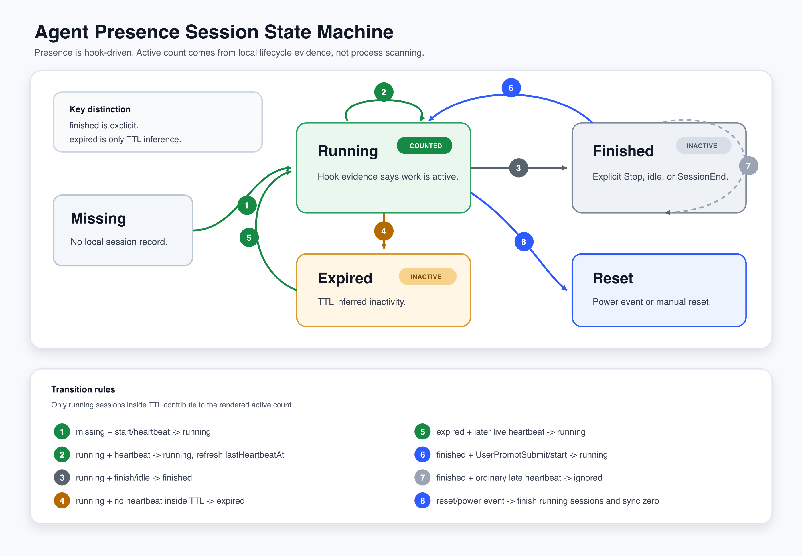

# Hook Pipeline And State

How recorded hook events flow from the local queue through normalization, session state, rendering, and debounced provider updates. For the system overview, CLI hook-graph boundary, observability, failure model, and security boundaries, see [overview.md](overview.md).

## State Store

`src/state-store.ts` loads and saves the local state as JSON under the user state directory. Loading parses the file with zod/mini schemas: a field or map entry whose value does not parse loads as missing, never as a failed load, and top-level fields the release does not know are dropped on the next save. The hook event queue's fields `queueApplied` and `queueOwed` are the exception (see [Hook Event Queue](#hook-event-queue) for the rules across releases): their schemas (`src/queue/schema.ts`) are loose at every level, so keys and fields the release does not know load as they are and are written back on the next save; a value that is not a list or an object loads as absent, and an entry that does not parse is dropped. `src/state.ts` keeps the state types and the session rules (`applyAgentEvent`, `isSessionBoundaryEvent`) without schemas or I/O, so the hook path can use them without loading zod. Updates are guarded by the state lock (`withStateLock` in the state store) so the worker and the commands that took over do not clobber each other. The state lock is the kit's process lock (`@rivus/agent-kit-collab/process-lock`) on `<state>.lock.db`: a SQLite database that the kernel unlocks when its holder exits or crashes, so a lock is never reclaimed. A writer waits up to 2 seconds for it and then fails. The `<state>.lock` directory that earlier releases locked is left alone, because those releases delete that path. The old mkdir lock and the SQLite lock do not exclude each other; uninstalling the previous release first, as every upgrade from 0.9.0 or earlier requires, keeps the two versions from running side by side.

State has two layers:

```json
{
  "sessions": {
    "thread_id": {
      "id": "thread_id",
      "source": "codex",
      "kind": "coding",
      "status": "running",
      "startedAt": 1778576582452,
      "lastHeartbeatAt": 1778576891386
    }
  },
  "lastSlotUpdateAt": 1778577015486,
  "lastValue": "1 个 AI 牛马正在搬砖 | codex 1"
}
```

`sessions` is the event-derived truth. `lastSlotUpdateAt` and `lastValue` are the renderer/provider debounce checkpoint.

## Hook Event Queue

A hook run does not apply presence's work itself. It records one event in a durable queue and returns; one background process per state file applies the recorded events, does the follow-up work and publishes through the usual debounce. Every recorded event changes the state once, and its follow-up work (the dsh usage append, the usage refresh of a source with a session boundary) takes effect once, also when the worker is killed at any point. The exceptions are the [accepted limits](#accepted-queue-limits) below.

**The producer (the hook command).** `hook` interprets the payload in process (the interpretation rules above), takes no lock (it only checks whether the worker lock is held), writes no log line, reads no credential or transcript and makes no network call. In order it reads `<state>.epoch`, checks the `<state>.disabled` tombstone, writes one record (temporary file, then `rename` — the rename is the recording point), and checks with the kit's `isProcessLockHeld` whether a process holds the worker lock: if none does, or the holder's `<state>.worker.v` shows an older release, it starts a `agent-presence worker` as a detached process; otherwise the holder applies the record. It prints its output (`{}` unless `--silent`) and exits 0 in every case; an event that cannot be recorded is lost. A run records one `event` record per interpreted event, one `skip` record (`missing-session-id`, `no-presence-source`, `ignored-event`) per skipped one, one `error` record per source-resolution diagnostic, and one `hook failed` error record when its own work throws — never a stop request.

**The queue directory and records.** `<state file>.queue/` (mode 0700) holds one 0600 file per event, named `<recordedAt>-<pid>-<hex>.json`. A record carries its record version `v`, its id, the recorded time, the epoch the producer read, and the normalized fields of the event — source, event name, session id, project, dsh usage when the source reports it, the transcript-root variables (`scanEnv`) on session boundaries, and payload key names for the diagnostic log. It never carries prompt text, tool arguments or credentials. Applied records are deleted; records an applier cannot parse move to `queue/failed/` and are kept for 7 days, and `.tmp-` files older than an hour are removed. Because the rename is the recording point, events an agent sends one after another (each hook exiting before the next starts) are applied in that order unless the system clock steps backwards between them. Each batch is sorted by recorded time, then file name; concurrent events have no defined order.

**The worker (`agent-presence worker`, not listed in help).** It holds the worker lock (`<state>.worker.lock.db`, the kit's SQLite process lock, never deleted) and writes its record version to `<state>.worker.v` while it holds the lock. Two lanes run concurrently: the apply lane lists the queue every 250 ms and, under the state lock, applies each batch in recorded order at its recorded times, saves the applied ids (`queueApplied`) and the follow-up work the records owe (`queueOwed`: dsh usage appends, per-source usage refreshes, the rendered sync), then deletes the applied files; the follow-up lane works off the owed items one at a time — appending dsh usage with the record id, scanning the owing source's transcripts with the recorded environment, publishing the rendered value through the usual debounce. While a worker runs, a recorded event reaches the state within 1 second, also during a publish or a usage scan, because the apply lane runs every 250 ms apart from the follow-up lane (`test/queue-worker.test.ts` checks this with a hung publish). The abort signal each follow-up item takes lets the worker end the item in progress when it leaves the lock, for example to hand over to a command, and each provider publish times out after 30 seconds as a failed attempt, so no call hangs the follow-up lane. A follow-up item that fails is not tried again by the same worker until new work for it is owed (a sync until an applied event or a refresh owes one, a refresh until a newer boundary, a dsh append not at all), so a failing provider cannot keep a worker busy; the next worker tries each again. A backlog is never dropped; above 10,000 records the worker logs a warning. The worker reads the configuration file before each batch and takes credentials and provider overrides from the environment of the hook or command whose run started it, passed on unchanged by any worker in between. One state file uses one configuration: hooks or commands with another credential, state path or config path for the same state file are not supported. A worker exits when idle (5 minutes with nothing pending), for a command's stop request, for a record of a newer release (it leaves the record to that release's worker), for the tombstone, or when applying keeps failing for a whole idle interval. Every exit deletes `<state>.worker.v` and releases the lock, then lists the queue once more: an idle worker that finds a record retakes the lock (or waits as a started worker when a command's request is live or another process took it), a holder that stopped for a stop request and a command that leaves start a worker when records or owed work remain, and a worker leaving for a newer record, for the tombstone, or because applying kept failing for a whole idle interval starts none.

**Started workers.** A worker started by a producer, a command or a stopping worker repeats the producer's check every 250 ms for up to 60 seconds. It exits at the tombstone, makes no try while a command's stop request is live, takes a free lock with one non-waiting try (it checks first, because a try against a held lock costs about 125 ms), exits once `<state>.worker.v` shows its release or a newer one, and otherwise waits. Every holder, worker or command, writes `<state>.worker.v` right after taking the lock and deletes it right before releasing it. So a burst of hooks leaves one worker, and no worker yields the lock to another worker.

**Commands take over.** `status`, `reset`, `flush` and `update`, the shutdown watcher's `reset` included, write a stop request (`<state>.worker.stop.<token>` holding their pid), touch it every 2 seconds while they wait and write it again if a reader deleted it, and take the worker lock within 10 seconds or fail as a failed command does. A request is live while its pid is alive and its modification time is within 6 seconds of the reader's clock, before or after; a process that finds a stale request deletes it. A holding worker stops at its next 250 ms iteration and aborts the follow-up item in progress, which stays owed, so it hands over within about a second; it releases the lock only after its current batch has saved and that item has ended. A command never yields the lock; a second command waits for it. The command applies the pending records, appends the owed dsh usage under one log-lock deadline (`reset` leaves the dsh appends and usage refreshes to the next worker), reads its `now` after applying, and then runs its own code. The shutdown watcher waits for `reset --force --silent` without a deadline, so the takeover wait, one pass over the pending records, the credential read and the publish timeout bound the shutdown delay. When a command leaves, successful or not, it starts a worker if records or owed work remain. `worker --stop` takes over, applies and works off everything pending, then writes the tombstone.

**Tombstone and epoch.** `uninstall --all` writes `<state>.disabled`, takes over, deletes the queue directory, the stop-request files and the state, and keeps `<state>.worker.lock.db` and `<state>.epoch`. While the tombstone exists, producers record nothing, workers exit, and the commands change nothing: `reset`, `flush` and `update` print `{status: 'skipped', reason: 'disabled', value}` with the last published value, and `status` prints the loaded state without saving. An event recorded by a hook that was already running when `uninstall --all` began is never applied. `setup` removes the tombstone before login: it deletes the stale records, raises the epoch, and hooks record again; a record written with the old epoch around an uninstall is deleted unapplied. Plain `uninstall` leaves the queue alone, and the worker exits when idle.

**Upgrade and downgrade.** Upgrading from a release without the queue: uninstall that release with its own `agent-presence uninstall` first, then install and run `setup` — the two releases do not run side by side. Upgrading between two releases with the queue needs no step: an older worker leaves when it lists a newer record, and the worker that record's producer started takes over. Downgrading runs `agent-presence worker --stop` with the new release first, then the previous release's `setup` if that release has the queue. Downgrading to an older queue release without `worker --stop` leaves records that release cannot apply: its workers stop at the first one, and each hook starts a worker that leaves at once, until the newer release's `worker --stop` runs.

### Across Queue Releases

After an upgrade between queue releases, processes of both can take turns at the worker lock: a command started before the upgrade, a deferred `flush` the older worker scheduled (it runs the scheduling release's CLI), a worker either of them starts, or a command run from another installed release. These rules keep them compatible:

- A record's `v` rises with an incompatible record change and whenever a release adds a kind of owed work or a built-in source. Appliers parse `v` first, apply records of their own `v` or lower, and stop at the first higher one, leaving it in place. An older worker that lists a newer record applies the records before it and leaves without starting a worker; the worker that record's producer started takes the lock.
- Every queue release keeps these names and formats: the queue directory and its record file names (the leading 13-digit recorded time and the whole name are the sort key, the name without `.json` is the record id), the `.tmp-` prefix and `failed/`; a record's top-level `v`; `<state>.epoch` and `<state>.worker.v` as decimal text, read as `0` when missing or unparsable, so a producer that reads `0` from a holder that has not written its version yet starts a worker; `<state>.disabled` as an existence check; `<state>.worker.lock.db` with the kit's SQLite lock, so a release pins only kit versions whose lock on that file excludes the earlier kit's; `<state>.worker.v.beat` as versioned diagnostic JSON (version 2, `recovery: self-watchdog`, pid and beat time; version 1 is ignored); the stop-request file name, its decimal pid, the 2-second touch, the 6-second bound and the 10-second takeover wait; the lock paths `<state>.lock.db` and `<log>.lock.db`; and the record id in a dsh usage line.
- `queueApplied` and `queueOwed` are only added to. A later release adds a `queueOwed` key for a new kind of owed work, or a field an older release can ignore on an entry or on an object inside one (`usage`, `scanEnv`), and never changes or removes a field. A field an older release cannot ignore, or a scanner for a source an earlier release has without one, goes into a new kind of owed work. Every release parses these fields loosely, writes back what it does not know, changes known entries in place, and works off only the owed work it can do: the kinds it knows, except a `usageRefresh` entry for a source outside its merged source table, which stays owed without delaying its idle exit or making it start a worker. Applied ids and owed work never go into a new top-level state field, because older releases drop those.

### Accepted Queue Limits

- A worker crash right after a producer found the lock held leaves that record pending until a later hook or command.
- A command killed while it holds the lock, for example by a signal, skips its leaving order: records renamed during the rest of its run (seconds) wait for the next hook or command.
- With an older queue release at the lock: an older command runs its own code without the newer pending records, which a newer worker applies after it, so after an older `reset` a session that a pending newer `SessionStart` starts is running. Newer records wait for a later hook or command when older commands hold the lock for more than a started worker's 60 seconds, alone or one after another, or when a holder crashes and an older process takes the lock next while a newer producer checks before that process writes its version. Owed work only the newer release can do waits while older processes hold the lock, also past an older worker's idle exit.
- A dedicated worker CLI starts a watchdog thread while holding the worker lock. Its main thread updates a shared monotonic timestamp and the diagnostic `<state>.worker.v.beat` every 2 seconds, independently of apply batches, scans and publishes. When that timestamp is at least 90 seconds stale and a command's stop request is live (the same pid/6-second checks as above), the watchdog sends SIGKILL **only to its own process**. It never signals a pid read from a file, so stale files, older holders and reused pids cannot target another process. One shared atomic value holds the heartbeat timestamp or the released/terminating sentinel, so a heartbeat during request I/O invalidates the stale observation before termination can win. It also arbitrates termination against release: release disarms and joins the monitor before deleting metadata and unlocking; a monitor that won termination prevents release from handing the lock to another actor in the same process. Commands never enable a watchdog, and clear a preceding beat on acquisition. A command waits the normal 10 seconds, then, only for a stale version-2 beat, allows one additional 4-second interval for self-recovery; it always takes the kernel lock before changing state. Unreadable, missing, old or unknown beats leave the normal timeout unchanged. Heartbeat write failures cannot trigger termination by themselves because the watchdog uses shared monotonic memory. Long asynchronous work stays healthy, irrespective of total batch duration. An asynchronous operation that never settles while the event loop keeps responding, a process suspended with all threads, a failed monitor, and older workers without a monitor still require manual recovery.
- When a later release turns the id of a configured source without a scanner into a built-in with one, an older holder works off the later release's owed refresh for it without scanning; that refresh is lost until the source's next boundary (inferred).
- An owed refresh for a source since removed from the configuration stays owed in every release; it only grows the state (inferred).
- After an upgrade from 0.9.0 or earlier, a deferred flush the previous release scheduled still runs that release's `flush` when due, and again while the provider rate-limits it. It ignores the queue and the tombstone and drops the queue fields when it saves, so the records of one batch can be applied twice and the owed items of that moment are lost. This is not handled.

## Hook Normalization

The hook pipeline maps each agent's lifecycle vocabulary to the shared session state:

```text
start event      -> running
heartbeat event  -> running with fresh lastHeartbeatAt
finish event     -> finished
idle event       -> finished
```

Current source mapping:

```text
Codex       SessionStart, UserPromptSubmit, PreToolUse, Stop
Claude Code SessionStart, UserPromptSubmit, PreToolUse, PostToolUse, Stop, StopFailure, SessionEnd, SubagentStart, SubagentStop
Gemini CLI  SessionStart, BeforeAgent, BeforeTool, AfterTool, AfterAgent, SessionEnd
opencode    session.created, command.executed, file.edited, message.*, permission.*, session.*, todo.updated, tool.execute.*
Pi          before_agent_start, turn_start, tool_execution_start, tool_execution_end, agent_end, session_shutdown
Grok        session_start, user_prompt_submit, pre_tool_use, post_tool_use, stop, stop_failure, session_end, subagent_start, subagent_stop (snake_case wire names; the PascalCase registration keys map the same way)
dsh         agent/session-start, agent/pre-step, tools/result, agent/turn-stopping, agent/status, agent/disposed, session/disposed (via managed dsh plugin)
```

Hooks print `{}` unless invoked with `--silent`, including Codex hooks that require valid pass-through output. Some runners treat events such as `PreToolUse` as permission gates and can read empty output as a block, so the installed command also ends in `|| echo '{}'` and prints `{}` even when the hook process fails. Presence does not consult the kit dialect's `passThrough`: the Codex dialect marks the context events (`SessionStart`, `UserPromptSubmit`) as `passThrough: ""`, which would silence successful context events. Earlier installations may carry `--silent` for Claude Code, Gemini CLI, opencode and Pi.

`hook --agent <kit agent id>` is the form setup installs. It reads the payload with `readHookEvent` from `@rivus/agent-kit/harness/events`, attributes the event to the presence source of the sniffed agent (`claude-code` → `claude`, `gemini-cli` → `gemini`, and `codex`, `grok`, `opencode`, and `pi` unchanged), and maps `nativeEvent` onto the internal names this state machine already uses, by the signal rule below. An agent with no presence source, such as Cursor running a Claude Code hook, logs one `hook skipped:` line and ends on the same skip path as a missing session id. For `hook --agent opencode` the session id is the one the kit's opencode dialect reads: the id the event names, or, for an event that names none (`file.edited`, a `session.error` without `sessionID`), the `currentSessionId` the kit bridge adds once it has seen a session; an event with neither is skipped as a missing session id. Stdout is presence's own rule for every agent and event: `{}` unless `--silent`. The kit dialect's `passThrough` is not consulted. When planning would place a presence observer where a foreign runner executes its own permission gate, the kit's `hookRegistrations` refuses it (`blocking-gate`) as a planning error, so setup fails before writing any agent target — a refusal, not a dropped hook.

opencode and Pi use only the kit-bridge forms `hook --agent opencode` and `hook --agent pi`: an old plugin or extension left at a bridge path shows up in setup as an `unmanaged-exists` conflict (see [Upgrading Previous Installations](installation.md#upgrading-previous-installations)). Their source resolvers retain only the session identity and project resolution the `--agent` path calls; the old opencode bridge's wrapped `{ event }` payload lookup and `OPENCODE_SESSION_ID` fallback are removed. `hook --source <id> --event <internal name>` and `hook --source <id>` with an internal event from its resolver keep their internal-name behavior for `claude`, `codex`, `gemini`, `grok`, `dsh`, and configured sources; configured sources reusing `builtin:opencode` or `builtin:pi` follow the same shipped resolver rule. Internal names are the Claude-style names the state machine uses, `Heartbeat`, and lowercase `start`, `finish`, and `heartbeat`. Raw `session.created`, `session.deleted`, `session.error`, and `session.idle` names count as heartbeats in direct `hook --source <any> --event <raw name>` calls and configured `match` sources resolving those names.

Signal rule for `hook --agent`: a per-agent table (`src/cli/hook-interpret.ts`) maps each native event name to an internal name, and `normalizeEvent` turns that into start, heartbeat, or finish. The mapped internal names keep their `--source/--event` signals, even where the kit phase differs. A name the table does not list takes the kit phase: start and finish as they are, and activity, blocked, or unknown as a heartbeat, because presence has three statuses and a permission or question prompt is activity.

```text
start      SessionStart (Claude Code, Codex, Gemini CLI; a compact one too), Grok session_start, Gemini BeforeAgent,
           opencode session.created, Pi before_agent_start and agent_start
heartbeat  tool, message, edit, and other activity; UserPromptSubmit (Claude Code, Codex, Grok user_prompt_submit);
           opencode session.status other than idle, permission.asked/updated, question.*; Pi turn_end
finish     Stop, StopFailure, SessionEnd and their Grok spellings, Gemini AfterAgent; opencode session.status idle,
           session.idle, session.error, session.deleted; Pi agent_end, agent_settled, session_shutdown
subagent   Claude Code SubagentStart/SubagentStop and Grok subagent_start/subagent_stop start and finish
           the subagent's own session and are not session boundaries
ignored    Pi session_start
```

Where this departs from the kit phase, it keeps presence's state machine intact. `UserPromptSubmit` and opencode's busy `session.status` are kit turn starts, but a start would reset a running session's `startedAt` and refresh the usage badge on every prompt; as a heartbeat, `UserPromptSubmit` still reopens a finished session. The kit counts a `compact` `SessionStart` as activity; presence restarts the session as before. Pi `session_start` only means the Pi UI is open (see the Pi paragraph below). The Claude-style payload names `UserPromptSubmit`, `PreToolUse`, `PostToolUse`, and `Stop` keep their signals in `hook --agent gemini-cli`; they are not in the Gemini registration set setup installs. Presence does not use the kit's `reduceLifecycle`/`heartbeatSignal` policy, which ignores session-scope starts and never starts or finishes a subagent session.

The seven sources above are built in. They live in a source table that a user's config can extend, override, or disable without a core change; see [Source Table](providers-and-sources.md#source-table).

For Pi specifically, the extension intentionally does **not** treat the Pi `session_start` event as an active-session signal — that event fires whenever the Pi TUI opens, including when the user has not yet submitted a task. Activation is gated on `before_agent_start`, which only fires after the user submits a prompt. Heartbeats come from `turn_start` and `tool_execution_*`. Finishes come from `agent_end` (turn done) and `session_shutdown` (Pi quit, reload, or session switch).

For dsh, there is no kit adapter: `setup` automatically rewrites an existing presence Cordis plugin identified by its marker to call the shim, without prompting, including in a non-interactive terminal or with `--yes`. Only a fresh installation asks for confirmation, and is offered only when dsh is detected in an interactive terminal. If reading the plugin to check its marker fails, setup prints one note, skips the dsh step and continues provider setup and runtime pruning. `--no-hooks` neither inspects nor rewrites the plugin. The single-file plugin lives in `~/.dsh/plugins/` and is registered in the home-level `~/.dsh/cordis.patch.yml` (which applies to every profile). The plugin bridges dsh lifecycle events to `agent-presence hook --source dsh`: `agent/status` running sends `UserPromptSubmit` and idle sends `Stop`, so a finished session reopens on the next prompt or goal and schedule wake-up; `agent/turn-stopping` is only a heartbeat, because a listener can steer the turn into another step; `agent/disposed` and `session/disposed` also send `Stop`. It also reports each model call's token usage in the hook payload, which the producer copies into the record; the worker appends it to a local usage log (`~/.agent-presence/usage-events.log`, `src/usage-events-log.ts`) under that file's log lock. A line can carry the id of the record it came from, and the reader counts a repeated id once. The dsh `scanUsage` reads that log back through a zod/mini line schema, so dsh contributes to the same usage windows and totals as the transcript-scraping sources without scraping dsh's zstd transcripts.

Setup installs Grok hooks through the harness bundle. The source is registered in the table (it appears in `source list`) and accepts Grok hook payloads through `agent-presence hook --source grok` and through `hook --agent grok`. With `--source grok --event <presence event name>`, the `--event` name drives the lifecycle mapping. Without `--event`, and with `--agent grok`, the payload's event name maps through the same Grok table (`GROK_EVENTS` in `src/hooks/grok.ts`), snake_case or PascalCase; on `--source grok` a name outside it counts as a heartbeat. The `builtin:grok` resolver reads the payload with the kit's Grok dialect (`readHookEvent`): the event name from `hookEventName`/`hook_event_name`, the session id from `sessionId`/`session_id` (env fallbacks `GROK_HOOK_EVENT`/`GROK_SESSION_ID`), and the project from `cwd`, falling back to `PWD`. Subagent start and stop compose the session id the same way Claude's resolver does, from `subagentId`/`subagentType`. Grok transcripts are decoded by `@rivus/agent-kit/transcript/usage` using Grok's logged per-turn cost; see [Token usage (`scanUsage`)](providers-and-sources.md#token-usage-scanusage).

The harness ledger owns the artifacts setup installs. Planning compares the desired bundle, ledger and agent targets; applying the accepted plan preserves unrelated configuration and avoids duplicate registrations. The bundle and uninstall supply no markers of older releases, so entries from 0.9.0 or earlier require that release's own uninstall; see [Upgrading Previous Installations](installation.md#upgrading-previous-installations).

## Session State Machine



The editable SVG source for this diagram lives at [`assets/presence-state-machine.svg`](../assets/presence-state-machine.svg).

Each session record has one of three statuses:

```text
running   explicit local evidence says this agent session is working
finished  an explicit finish/idle event ended the current work turn
expired   TTL inferred inactivity because no heartbeat arrived in time
```

`finished` and `expired` are intentionally different. `finished` comes from an explicit lifecycle event and protects the state from late async hook traffic after a turn has stopped. `expired` is only an inactivity inference, so a later live heartbeat from the same session can reopen it.

The shared transition rules are:

```text
missing session + start/heartbeat       -> running
running + heartbeat                     -> running, refresh lastHeartbeatAt
running + finish/idle                   -> finished
running + no heartbeat inside TTL       -> expired
expired + start/heartbeat               -> running, refresh startedAt and lastHeartbeatAt
finished + ordinary late heartbeat      -> finished, ignored
finished + UserPromptSubmit/start       -> running, new active turn for same agent session
unknown finish id + matching source/project running session
                                         -> finish latest matching running session
reset / power event                      -> finish all running sessions, preserve cached usage, and sync zero
```

This gives the model two recovery paths without process scanning:

- Missed finish hooks are cleaned up by TTL expiry.
- Long-running sessions that keep working after a TTL expiry can become active again on the next real heartbeat.

## Active Semantics

Active means "currently doing agent work", not "the terminal is open".

```text
running session with heartbeat inside TTL -> active
finished session                         -> inactive
no heartbeat for TTL                     -> expired and inactive
expired session with later heartbeat     -> running again
sleep / lid close / logout / shutdown    -> reset to 0
wake                                     -> reset to 0 again
```

The default TTL is 3 minutes. This handles abnormal exits, hard kills, and missed finish hooks without scanning local processes. An expired session is not a terminal state; it is inactive until a later real heartbeat proves that the same agent session is working again.

## Rendering

`src/render.ts` groups active sessions by source and formats the slot value:

```text
0 -> AI 牛马暂未开工
1 -> 1 个 AI 牛马正在搬砖 | codex 1
N -> N 个 AI 牛马正在搬砖 | codex W · claude X · gemini Y · opencode Z
```

Templates are configurable through `agent-presence config render` and environment variables. Rendered values are capped at 200 characters before provider update.

## Debounce And Provider Updates

Slot writes are rate-limited because the slot provider should not be hammered by hook traffic. The worker applies recorded events to local state, then the renderer compares the newly rendered value with `lastValue` and `lastSlotUpdateAt`; the owed rendered sync (`queueOwed.renderedSync`) is what drives that comparison off the queue. It is settled in the locked save that records a successful publish of the value the state still renders, schedules or finds the deferred flush, or finds nothing to publish; a failed or aborted publish keeps it owed. If the worker dies or hands over during a publish, the next applier runs the sync again, and because the interrupted publish already claimed the interval, that sync schedules the forced publish one debounce interval later. `update --value` settles it when its explicit publish succeeds, so a later worker does not overwrite the explicit value with the rendered one.

Normal updates obey the debounce interval. `update --force` and `reset --force` bypass the local debounce when the user or power watcher explicitly asks for a sync.

A debounced or rate-limited write schedules the internal `flush --force --silent` command. `flush` renders the already-persisted presence and usage cache; it never collects transcripts. This keeps retrying provider delivery separate from the explicit `update` command, whose application semantics include a complete usage refresh.

Network I/O is kept outside the state mutation lock. That keeps hook contention small and prevents a slow provider request from blocking unrelated lifecycle writes.
